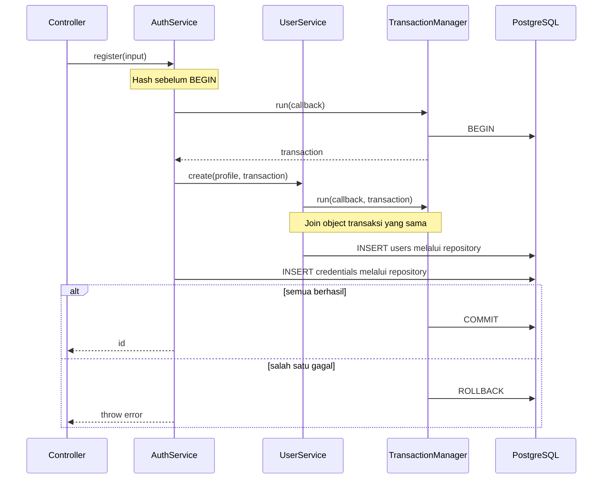

# Arsitektur dan Panduan Implementasi

Dokumen ini memuat keputusan arsitektur dan pola implementasi rinci untuk aplikasi Express 5, TypeScript ESM, Sequelize, PostgreSQL, Awilix, dan Valfuse. Bab 1–18 menjelaskan struktur modul, batas tanggung jawab, alur request, persistence, deployment, serta rationale desain. Contoh dan daftar package dipindahkan dari baseline implementasi sebelumnya; bila berbeda dengan source atau dokumen canonical, ikuti source dan dokumen canonical.

Source code adalah bukti implementasi. Untuk kontrak API gunakan [OpenAPI](api/openapi.yaml) dan [API baseline](api/api-baseline.md); untuk keputusan terbaru gunakan [ADR](adr/README.md); untuk workflow dan status pemeriksaan gunakan [panduan development](development.md) serta [catatan verifikasi](verification.md). Contoh di sini menjelaskan pola dan rationale, bukan menggantikan sumber canonical tersebut.

## 1. Keputusan proyek dan batas perubahan

| Area                 | Keputusan                                                                                                          |
| -------------------- | ------------------------------------------------------------------------------------------------------------------ |
| Arsitektur           | Modular berdasarkan fitur, controller–service–repository seperti awal                                              |
| Folder user          | `src/modules/users/` mengelompokkan file pada subfolder sesuai tanggung jawab                                      |
| Fitur role           | `src/modules/roles/` memiliki katalog dan aturan assignment role berdasarkan level                                 |
| Fitur auth           | `src/modules/auth/` memakai subfolder tanggung jawab yang sama saat diperlukan; fokus registrasi/kredensial        |
| Shared               | Tetap `shared/errors`, `shared/http`, `shared/logging`; tambah `shared/database` untuk transaksi/migration         |
| Configuration        | Tetap `src/config/environment.ts` dan `src/config/database.ts`                                                     |
| Entry point          | Tetap `bin/www.ts`, application factory `src/app.ts`                                                               |
| Dependency injection | Awilix CLASSIC + strict; menggantikan wiring factory manual tanpa mengganti arsitektur fitur                       |
| Transaksi            | Helper konkret `TransactionManager`; object `Sequelize.Transaction` diteruskan eksplisit lintas service/repository |
| Migration            | File TypeScript di folder root `migrations/`, dijalankan Umzug; tidak auto-sync model aplikasi                     |
| Seeder               | File berurutan di `seeders/`, idempotent, transactional, dan selalu dijalankan setelah migration                   |
| Source               | Semua file dalam `src` adalah `.ts`; JavaScript hasil compile hanya di `dist`                                      |
| Tipe                 | Named type/interface declarations di `*.type.ts` dekat file pemiliknya                                             |
| Kontrak HTTP         | OpenAPI canonical mengatur wire format, status, locale, dan operasi API                                            |
| Tooling              | ESLint, Prettier, lint-staged, Husky, typecheck, generator drift checks, Node tests dan coverage service           |
| AI agent             | AGENTS.md, workflow, source-of-truth policy, task template, dan definition of done                                 |
| Database test/CI     | Compose PostgreSQL 16.15, env test terpisah, readiness deadline, dan Bitbucket Pipelines                           |

Subfolder fitur mengikuti tanggung jawab (`controller`, `routes`, `schema`, `service`, `repository`, `model`, `mapper`, `entity`, `errors`, `security`, `types`) dan hanya dibuat bila berisi file. Auth memakai kontrak profil Users dan kontrak role default; Roles memakai kontrak assignment role yang dimiliki Users. Users tidak mengimpor Auth atau Roles. Middleware autentikasi disuntikkan ke router dari composition root. Tidak ada folder `domain/application/infrastructure/presentation`, abstract UnitOfWork port, opaque WorkContext, atau composition root per layer. Interface repository tetap menjadi kontrak yang dibutuhkan service, bukan alasan menambah lapisan arsitektur.

Perubahan yang memang diperlukan: tambah auth untuk skenario register lintas service, tambah roles untuk assignment satu role per User berdasarkan level, pindahkan named types ke file `.type.ts`, tambah container dan transaksi bersama, pecah environment database, dan selaraskan contoh HTTP lama dengan OpenAPI. Request/response types (DTO transport), entity, dan model dibedakan berdasarkan tugas file dalam modul yang sama; lihat katalog tunggal di `docs/naming.md`.

## 2. Standar naming

Konvensi lengkap untuk identifier, file, tipe per boundary, schema OpenAPI, service, persistence, error, locale, log, migration, dan test didefinisikan pada [konvensi naming](naming.md); alasan keputusannya ada di [ADR 0002](adr/0002-boundary-naming.md). Nama HTTP memakai suffix ketika membedakan peran nyata (`Request`, `PathParams`, `Response`); pagination daftar user memakai `UserListPagination` karena namanya mengikuti isi, bukan lokasi query string. Envelope memakai `ApiResponseBase`/`ApiSuccessResponse`/`ApiFailureResponse`, entity memakai nama domain, dan tipe ORM memakai suffix `Model`/`ModelRow`.

Naming JSON camelCase dan error UPPER_SNAKE_CASE pada contoh awal disesuaikan ke kontrak HTTP yang kamu berikan. Identifier TypeScript tetap camelCase; mapper menangani batas wire/database. Ini penyesuaian kontrak, bukan perubahan arsitektur.

## 3. Struktur proyek

| Folder                         | File langsung di dalamnya                                                                                                                                                                                                                                                                                                                                                                      |
| ------------------------------ | ---------------------------------------------------------------------------------------------------------------------------------------------------------------------------------------------------------------------------------------------------------------------------------------------------------------------------------------------------------------------------------------------- |
| `src/`                         | `app.ts`, `container.ts`, `container.type.ts`                                                                                                                                                                                                                                                                                                                                                  |
| `src/config/`                  | `database.ts`, `environment.ts`, `environment.type.ts`                                                                                                                                                                                                                                                                                                                                         |
| `src/modules/users/`           | `controller/`, `entity/`, `errors/`, `mapper/`, `model/`, `repository/`, `routes/`, `schema/`, `service/`, `types/`                                                                                                                                                                                                                                                                            |
| `src/modules/roles/`           | `controller/`, `entity/`, `mapper/`, `model/`, `repository/`, `routes/`, `schema/`, `service/`, `types/`                                                                                                                                                                                                                                                                                       |
| `src/modules/auth/`            | `controller/`, `errors/`, `model/`, `repository/`, `routes/`, `schema/`, `security/`, `service/`, `types/`                                                                                                                                                                                                                                                                                     |
| `src/shared/errors/`           | `application-error.ts`, `application-error.type.ts`, `validation-error.ts`                                                                                                                                                                                                                                                                                                                     |
| `src/shared/http/`             | `error.middleware.ts`, `http-context.ts`, `http.type.ts`, `request-context.middleware.ts`, `response.ts`, `validate-request.middleware.ts`                                                                                                                                                                                                                                                     |
| `src/shared/database/`         | `database-error.ts`, `migration.type.ts`, `migrator.ts`, `seeder-runner.ts`, `seeder.type.ts`, `transaction-manager.ts`                                                                                                                                                                                                                                                                        |
| `src/shared/logging/`          | `logger.ts`                                                                                                                                                                                                                                                                                                                                                                                    |
| `src/modules/auth/security/`   | `node-argon2-password-hasher.ts`, `password-hasher.type.ts`, generated `index.ts`                                                                                                                                                                                                                                                                                                              |
| `src/generated/`               | `openapi.type.ts`                                                                                                                                                                                                                                                                                                                                                                              |
| `src/generated/localization/`  | `localization.ts`, `localization.type.ts`                                                                                                                                                                                                                                                                                                                                                      |
| `migrations/`                  | Timestamped schema changes, termasuk migration Role, credential, dan sesi auth                                                                                                                                                                                                                                                                                                                 |
| `seeders/`                     | Seeder data awal bernama `<timestamp>-<name>.seeder.ts`                                                                                                                                                                                                                                                                                                                                        |
| `bin/`                         | `migrate.ts`, `seed.ts`, `www.ts`                                                                                                                                                                                                                                                                                                                                                              |
| `scripts/`                     | `check-source-layout.ts`, `generate-api-docs.ts`, `generate-barrel.ts`, `generate-localization.ts`, `setup-environment.ts`, `wait-for-database.ts`                                                                                                                                                                                                                                             |
| `assets/localizations/common/` | `en.json`, `id.json`                                                                                                                                                                                                                                                                                                                                                                           |
| `docs/api/`                    | `api-baseline.md`, `openapi.md`, `openapi.yaml`                                                                                                                                                                                                                                                                                                                                                |
| `tests/unit/`                  | `container.test.ts`, `environment.test.ts`, `migration.test.ts`, `password.test.ts`, `transaction.test.ts`                                                                                                                                                                                                                                                                                     |
| `tests/http/`                  | `api.test.ts`                                                                                                                                                                                                                                                                                                                                                                                  |
| `tests/integration/`           | `registration.test.ts`, `user.repository.test.ts`                                                                                                                                                                                                                                                                                                                                              |
| `tests/helpers/`               | `harness.ts`, `harness.type.ts`                                                                                                                                                                                                                                                                                                                                                                |
| `.husky/`                      | `install.ts`, `pre-commit`, `pre-push`                                                                                                                                                                                                                                                                                                                                                         |
| `docs/`                        | `development.md`, `task-template.md`, `verification.md`                                                                                                                                                                                                                                                                                                                                        |
| Root proyek                    | `.dockerignore`, `.env.example`, `.env.test.example`, `.gitattributes`, `.gitignore`, `.npmrc`, `.nvmrc`, `.prettierignore`, `.prettierrc.json`, `AGENTS.md`, `Dockerfile`, `README.md`, `bitbucket-pipelines.yml`, `compose.yaml`, `eslint.config.mjs`, `lint-staged.config.mjs`, `package.json`, `redocly.yaml`, `tsconfig.build.json`, `tsconfig.json`, `valfuse.yaml`, `package-lock.json` |

Source yang sebelumnya bernama `user.types.ts` dipisah menurut kebutuhan dan memakai suffix singular `.type.ts`. File dikelompokkan menurut tanggung jawab, dengan kedalaman satu folder di dalam modul fitur. Buat folder dan file hanya ketika tanggung jawab itu ada.

## 4. Dependency final dan setup

Manifest dan lockfile adalah sumber daftar dependency serta versinya. Stack menggunakan Argon2id dari `node:crypto`, bukan package Argon2 terpisah.

| Dependency                                             | Penggunaan                                                                |
| ------------------------------------------------------ | ------------------------------------------------------------------------- |
| `awilix`                                               | Container, CLASSIC injection, strict lifetime, scope per request          |
| `umzug`                                                | Migration runner source TS/compiled JS dan SequelizeStorage               |
| `husky`                                                | Instalasi Git hooks development                                           |
| `lint-staged`                                          | ESLint/Prettier untuk file staged                                         |
| `@valfuse-node/express`                                | Localization middleware request-scoped                                    |
| `@valfuse-node/validation`                             | Schema dan engine validasi body/query/path                                |
| `@valfuse-node/localization`                           | Compiler locale dan runtime manifest TypeScript                           |
| `@valfuse-node/barrel`                                 | Generated public facade security dengan allowlist                         |
| `express`, `cors`, `helmet`, `express-rate-limit`      | HTTP/router, izin origin browser, headers, rate limit                     |
| `sequelize`, `pg`, `pg-hstore`                         | ORM, driver, codec dialect PostgreSQL Sequelize 6                         |
| `node:crypto`                                          | Argon2id, salt acak kriptografis, dan perbandingan hash konstan waktu     |
| `pino`, `debug`                                        | Log aplikasi terstruktur dan diagnostik startup namespace                 |
| `typescript`, `tsx`, `@types/*`                        | Typecheck/build, loader dev/test/migration, declaration dependency        |
| `eslint`, `@eslint/js`, `typescript-eslint`, `globals` | Flat config dan typed linting                                             |
| `prettier`                                             | Formatter tunggal                                                         |
| `@redocly/cli`, `openapi-typescript`                   | Lint/bundle/HTML dokumentasi dan generated OpenAPI request/response types |

Tidak perlu `awilix-express`, `reflect-metadata`, `sequelize-cli`, CLS library, dotenv, test framework tambahan, atau ESLint plugin yang menjalankan Prettier. Node menyediakan env-file/test runner; tsc tidak memerlukan decorator DI. Umzug dipakai sebagai satu runner migration, sehingga sequelize-cli tidak ditambahkan.

`pg-hstore` dipertahankan sesuai baseline dialect PostgreSQL Sequelize 6; tidak perlu membuat field HSTORE buatan hanya agar terlihat terpakai. `pg` tidak membuat pool aplikasi kedua. Pino dan debug tidak mencatat event request yang sama dua kali.

Manifest dan lockfile tidak disalin di dokumen ini agar versi tidak menyimpang dari source. Lihat [package.json](../package.json) dan [package-lock.json](../package-lock.json); quickstart tersedia di [README](../README.md).

**.nvmrc**

```text
24.19.0
```

**.npmrc**

```text
engine-strict=true
save-exact=true
```

```bash
node --version
npm --version

# Ekstrak paket source atau gunakan root hasil clone.
cd express-rest-api-boilerplate
# Untuk ZIP yang belum menjadi Git repository, jalankan git init sebelum npm ci.
npm ci
npm run env:setup
npm run db:up
npm run db:migrate
npm run db:seed
npm run check
npm run dev
```

Node baseline 24.19.x, npm 12.0.0. `allowScripts` membatasi esbuild yang digunakan tsx; override uuid Sequelize tetap dipertahankan. Commit lockfile hasil npm install dan gunakan npm ci sesudahnya. API key tidak ditambahkan; endpoint akun sendiri memakai opaque bearer token dari sesi auth.

## 5. TypeScript, lint, ESLint, format, dan Husky

ESLint memeriksa correctness termasuk typed rules. Prettier menjadi satu formatter. `lint` adalah npm script yang menjalankan ESLint, bukan dependency linter kedua.

| Perintah                | Perilaku                                                                                                 |
| ----------------------- | -------------------------------------------------------------------------------------------------------- |
| `npm run lint`          | ESLint tanpa menulis                                                                                     |
| `npm run lint:fix`      | Perbaikan ESLint otomatis                                                                                |
| `npm run format`        | Format source/config/docs yang relevan                                                                   |
| `npm run format:check`  | Periksa format tanpa menulis                                                                             |
| `npm run typecheck`     | Periksa tipe seluruh proyek                                                                              |
| `npm run layout:check`  | Pastikan src seluruhnya TS dan exported named types berada di file type                                  |
| `npm run check`         | Layout, API/generated checks, typecheck, lint, format, unit/HTTP tests                                   |
| `npm run test:coverage` | Service yang dimuat suite mencapai minimal 90% line/function coverage; test group kosong gagal eksplisit |
| `npm run ci`            | Check, service coverage, readiness DB test, integration PostgreSQL, build                                |

Pre-commit menjalankan lint-staged: ESLint fix kemudian Prettier pada code; Prettier pada JSON/YAML/Markdown. Globs dibedakan agar dua task paralel tidak mengedit file yang sama. Typecheck tidak dijalankan dengan daftar staged filenames karena memerlukan konteks proyek penuh.

Pre-push menjalankan `npm run check`. Integration test dijalankan CI yang menyediakan database test. Hook lokal dapat dilewati sehingga CI tetap menjadi quality gate. Tidak ada task `git add` manual karena lint-staged menangani staging hasil perbaikan.

Husky 9 memakai file hook sederhana tanpa bootstrap `husky.sh` lama. Installer skip pada HUSKY=0, CI=true, NODE_ENV=production, atau tidak ada Git checkout. Docker menyalin installer sebelum npm ci agar lifecycle prepare production tidak merujuk file yang belum ada. Hook memakai LF.

**tsconfig.json**

```json
{
  "compilerOptions": {
    "target": "ES2023",
    "lib": ["ES2023"],
    "module": "NodeNext",
    "moduleResolution": "NodeNext",
    "rootDir": ".",
    "outDir": "dist",
    "strict": true,
    "noUncheckedIndexedAccess": true,
    "exactOptionalPropertyTypes": true,
    "verbatimModuleSyntax": true,
    "esModuleInterop": true,
    "forceConsistentCasingInFileNames": true,
    "skipLibCheck": true,
    "sourceMap": true,
    "types": ["node"],
    "resolveJsonModule": true
  },
  "include": [
    "src/**/*.ts",
    "bin/**/*.ts",
    "scripts/**/*.ts",
    "tests/**/*.ts",
    ".husky/install.ts",
    "migrations/**/*.ts",
    "seeders/**/*.ts"
  ],
  "exclude": ["node_modules", "dist"]
}
```

**tsconfig.build.json**

```json
{
  "extends": "./tsconfig.json",
  "include": ["bin/**/*.ts", "src/**/*.ts", "migrations/**/*.ts", "seeders/**/*.ts"],
  "exclude": ["node_modules", "dist", "tests"]
}
```

**eslint.config.mjs**

```javascript
import js from "@eslint/js";
import globals from "globals";
import tseslint from "typescript-eslint";
import { defineConfig, globalIgnores } from "eslint/config";

export default defineConfig([
  globalIgnores(["dist/**", "coverage/**", "src/generated/**"]),
  {
    files: ["**/*.ts"],
    extends: [js.configs.recommended, tseslint.configs.recommendedTypeChecked],
    languageOptions: {
      globals: globals.node,
      parserOptions: { projectService: true, tsconfigRootDir: import.meta.dirname },
    },
    rules: {
      "@typescript-eslint/consistent-type-imports": "error",
      "@typescript-eslint/no-unused-vars": ["error", { argsIgnorePattern: "^_" }],
    },
  },
  {
    files: ["tests/**/*.ts"],
    rules: { "@typescript-eslint/require-await": "off" },
  },
  {
    files: ["**/*.mjs"],
    extends: [js.configs.recommended],
    languageOptions: { globals: globals.node },
  },
]);
```

**lint-staged.config.mjs**

```javascript
export default {
  "*.{ts,mts,cts,mjs,cjs,js}": ["eslint --fix", "prettier --write"],
  "*.{json,md,yaml,yml,html,css}": "prettier --write",
};
```

**.prettierrc.json**

```json
{
  "semi": true,
  "singleQuote": false,
  "trailingComma": "all",
  "printWidth": 100
}
```

**.prettierignore**

```text
node_modules
dist
coverage
package-lock.json
src/generated
src/modules/auth/security/index.ts
docs/api/openapi.md
.husky/_
```

**.husky/install.ts**

```typescript
import { existsSync } from "node:fs";
if (
  process.env.HUSKY !== "0" &&
  process.env.CI !== "true" &&
  process.env.NODE_ENV !== "production" &&
  existsSync(".git")
) {
  const husky = (await import("husky")).default;
  const result = husky();
  if (result) throw new Error(result);
}
export {};
```

**.husky/pre-commit**

```sh
npm exec -- lint-staged
```

**.husky/pre-push**

```sh
npm run check
```

**.gitattributes**

```text
* text=auto eol=lf
.husky/* text eol=lf
```

**.gitignore**

```text
node_modules/
dist/
coverage/
.env
.env.*
!.env.example
!.env.test.example
*.log

.husky/_/

artifacts/
```

**scripts/check-source-layout.ts**

```typescript
import { readdir, readFile } from "node:fs/promises";
import path from "node:path";

const moduleRoot = path.join("src", "modules");
const featureDirectories = new Set([
  "controller",
  "entity",
  "errors",
  "mapper",
  "model",
  "repository",
  "routes",
  "schema",
  "service",
  "types",
]);

async function visit(directory: string): Promise<void> {
  for (const item of await readdir(directory, { withFileTypes: true })) {
    const file = path.join(directory, item.name);
    const modulePath = path.relative(moduleRoot, file);
    const isFeaturePath =
      modulePath !== ".." &&
      !modulePath.startsWith(`..${path.sep}`) &&
      !path.isAbsolute(modulePath);
    const moduleParts = isFeaturePath ? modulePath.split(path.sep) : [];
    if (item.isDirectory()) {
      if (moduleParts.length === 2 && !featureDirectories.has(item.name))
        throw new Error("Use a recognized feature responsibility directory: " + file);
      if (moduleParts.length > 2)
        throw new Error("Keep feature responsibility directories one level deep: " + file);
      await visit(file);
    } else {
      if (isFeaturePath && moduleParts.length !== 3)
        throw new Error("Place feature files inside a responsibility directory: " + file);
      if (!item.name.endsWith(".ts"))
        throw new Error("src contains a non-TypeScript file: " + file);
      if (!/^[a-z0-9]+(?:[.-][a-z0-9]+)*\.ts$/.test(item.name))
        throw new Error("Invalid file naming: " + file);
      if (!file.includes(path.sep + "generated" + path.sep) && !item.name.endsWith(".type.ts")) {
        const source = await readFile(file, "utf8");
        if (/^\s*export\s+(?:interface|type)\s+/m.test(source))
          throw new Error("Move exported type declarations to *.type.ts: " + file);
      }
    }
  }
}
await visit("src");
```

## 6. Environment, PostgreSQL, dan CORS

`DATABASE_URL` dihapus dari setup. Database dibentuk dari lima field terpisah. Environment divalidasi sekali saat startup dan diinjeksi sebagai value ke container; service tidak membaca process.env berulang kali.

**.env.example**

```text
NODE_ENV=development
HOST=127.0.0.1
PORT=3000
DATABASE_HOST=127.0.0.1
DATABASE_PORT=5432
DATABASE_NAME=express_rest_api_boilerplate
DATABASE_USER=postgres
DATABASE_PASS=development-only-password
DATABASE_SSL=false
DB_POOL_MAX=10
LOG_LEVEL=info
CORS_ORIGINS=http://localhost:5173
TRUST_PROXY_CIDRS=
RATE_LIMIT_MAX=300
DEBUG=
```

```dotenv
# Pilih salah satu mode berikut.
CORS_ORIGINS=*
CORS_ORIGINS=http://localhost:5173
CORS_ORIGINS=http://localhost:5173,https://app.example.com
```

Simpan hanya satu assignment CORS_ORIGINS pada file env sebenarnya. Format daftar adalah CSV, bukan JSON array. Wildcard tidak digabung origin spesifik. Exact origin tidak mengandung trailing slash/path. Mode wildcard mengirim header origin `*`; mode daftar hanya memberi header izin untuk origin yang cocok. Request non-browser/server tetap dapat mencapai API; CORS bukan authorization dan tidak menjanjikan 403 untuk origin lain.

`credentials: false` sesuai kontrak tanpa cookie/session. Jika nanti ada cookie authentication, revisi security/CSRF dan origin policy bersama. `DATABASE_SSL=true` memverifikasi sertifikat, bukan mengaktifkan rejectUnauthorized false.

Satu Sequelize pool per proses. Perhitungkan replica × proses × DB_POOL_MAX dan sisakan koneksi operasi/migration. Dedicated pg.Client hanya digunakan CLI migration untuk lock. `HOST=127.0.0.1` lokal, `0.0.0.0` di container; TRUST_PROXY_CIDRS hanya berisi proxy yang benar-benar dipercaya.

**src/config/environment.type.ts**

```typescript
export type Environment = {
  nodeEnv: "development" | "test" | "production";
  host: string;
  port: number;
  databaseHost: string;
  databasePort: number;
  databaseName: string;
  databaseUser: string;
  databasePass: string;
  databaseSsl: boolean;
  databasePoolMax: number;
  corsOrigins: "*" | string[];
  logLevel: string;
  rateLimitMax: number;
  trustProxyCidrs: string[];
};
```

**src/config/environment.ts**

```typescript
import type { Environment } from "./environment.type.js";

export function loadEnvironment(source: NodeJS.ProcessEnv = process.env): Environment {
  function required(name: string): string {
    const value = source[name];
    if (value === undefined || value.length === 0) throw new Error("Missing environment: " + name);
    return value;
  }
  function integer(name: string, fallback: number, min: number, max: number): number {
    const raw = source[name];
    const value = raw === undefined ? fallback : Number(raw);
    if (!raw?.trim() && raw !== undefined) throw new Error("Invalid environment: " + name);
    if (!Number.isInteger(value) || value < min || value > max)
      throw new Error("Invalid environment: " + name);
    return value;
  }
  const nodeEnv = source.NODE_ENV ?? "development";
  if (nodeEnv !== "development" && nodeEnv !== "test" && nodeEnv !== "production")
    throw new Error("Invalid NODE_ENV");
  const ssl = source.DATABASE_SSL ?? "false";
  if (ssl !== "true" && ssl !== "false") throw new Error("Invalid DATABASE_SSL");
  const origins = source.CORS_ORIGINS ?? "http://localhost:5173";
  let corsOrigins: Environment["corsOrigins"] = "*";
  if (origins.trim() !== "*") {
    corsOrigins = origins
      .split(",")
      .map((value) => value.trim())
      .filter(Boolean);
    if (!corsOrigins.length) throw new Error("Invalid CORS_ORIGINS");
    for (const origin of corsOrigins) {
      try {
        const parsed = new URL(origin);
        if (!["http:", "https:"].includes(parsed.protocol) || parsed.origin !== origin)
          throw new Error();
      } catch {
        throw new Error("Invalid CORS_ORIGINS");
      }
    }
  }
  const logLevel = source.LOG_LEVEL ?? "info";
  if (!["trace", "debug", "info", "warn", "error", "fatal", "silent"].includes(logLevel))
    throw new Error("Invalid LOG_LEVEL");
  return {
    nodeEnv,
    host: source.HOST ?? "127.0.0.1",
    port: integer("PORT", 3000, 1, 65535),
    databaseHost: required("DATABASE_HOST"),
    databasePort: integer("DATABASE_PORT", 5432, 1, 65535),
    databaseName: required("DATABASE_NAME"),
    databaseUser: required("DATABASE_USER"),
    databasePass: required("DATABASE_PASS"),
    databaseSsl: ssl === "true",
    databasePoolMax: integer("DB_POOL_MAX", 10, 1, 100),
    corsOrigins,
    logLevel,
    rateLimitMax: integer("RATE_LIMIT_MAX", 300, 1, 100000),
    trustProxyCidrs: (source.TRUST_PROXY_CIDRS ?? "")
      .split(",")
      .map((value) => value.trim())
      .filter(Boolean),
  };
}
```

**src/config/database.ts**

```typescript
import pg from "pg";
import type { ClientConfig } from "pg";
import { Sequelize } from "sequelize";
import type { Environment } from "./environment.type.js";

export function createPgConfig(environment: Environment): ClientConfig {
  return {
    host: environment.databaseHost,
    port: environment.databasePort,
    database: environment.databaseName,
    user: environment.databaseUser,
    password: environment.databasePass,
    ssl: environment.databaseSsl ? { rejectUnauthorized: true } : false,
    application_name: "express-rest-api-boilerplate",
    statement_timeout: 10000,
    connectionTimeoutMillis: 5000,
  };
}
export function createDatabase(environment: Environment): Sequelize {
  return new Sequelize(
    environment.databaseName,
    environment.databaseUser,
    environment.databasePass,
    {
      dialect: "postgres",
      dialectModule: pg,
      host: environment.databaseHost,
      port: environment.databasePort,
      dialectOptions: createPgConfig(environment),
      logging: false,
      pool: { max: environment.databasePoolMax, min: 0, acquire: 10000, idle: 30000 },
      define: { timestamps: true, underscored: true },
    },
  );
}
```

## 7. Awilix pada pola controller–service–repository

Container berada di `src/container.ts`, bukan di service. Konfigurasi memakai CLASSIC dan strict seperti permintaan. Class/factory didaftarkan eksplisit. Constructor parameter bernama userRepository harus cocok token userRepository; tsc tidak meminify nama parameter. Tidak memakai decorator, reflect-metadata, atau service locator dalam business logic.

| Dependency                          | Lifetime  | Alasan                                                                                      |
| ----------------------------------- | --------- | ------------------------------------------------------------------------------------------- |
| Environment                         | Value     | Satu hasil parsing konfigurasi                                                              |
| Database/logger/model/hasher        | Singleton | Resource per proses atau adapter stateless                                                  |
| Repository                          | Singleton | Tidak menyimpan transaksi aktif atau current user pada instance                             |
| TransactionManager                  | Singleton | Helper bersama yang melacak object transaksi terpisah; tidak ada current transaction global |
| UserService/AuthService/controllers | Scoped    | Satu graph per request                                                                      |

Container diekspor melalui factory agar test mendapat root terisolasi dan import file tidak langsung membuka database. `bin/www.ts` membentuk satu root proses. Ini versi operasional dari contoh `const container = createContainer(...)`; konfigurasi dan lifetime sama, hanya ownership dibuat eksplisit untuk startup/test/shutdown.

Middleware context membuat scope per request. Router resolve controller dari scope tersebut, bukan dari root saat startup. Scope di-dispose sekali pada finish/close. Strict mode menolak singleton menangkap scoped dependency. Disposal request tidak menutup database singleton; root disposer menutup pool saat shutdown.

**src/container.type.ts**

```typescript
import type { Environment } from "./config/environment.type.js";
import type { Sequelize } from "sequelize";
import type { Logger } from "pino";
import type { UserRepository } from "./modules/users/repository/user-repository.type.js";
import type { UserServiceApi } from "./modules/users/service/user-service.type.js";
import type { AuthCredentialRepository } from "./modules/auth/repository/auth-credential-repository.type.js";
import type { AuthSessionRepository } from "./modules/auth/repository/auth-session-repository.type.js";
import type { AuthServiceApi } from "./modules/auth/service/auth-service.type.js";
import type { PasswordHasher } from "./modules/auth/security/password-hasher.type.js";
import type { UserModel } from "./modules/users/model/user-model.type.js";
import type { AuthCredentialModel } from "./modules/auth/model/auth-credential-model.type.js";
import type { AuthSessionModel } from "./modules/auth/model/auth-session-model.type.js";
import type { UserController } from "./modules/users/controller/user.controller.js";
import type { AuthController } from "./modules/auth/controller/auth.controller.js";
import type { TransactionManager } from "./shared/database/transaction-manager.js";
export type Cradle = {
  environment: Environment;
  database: Sequelize;
  logger: Logger;
  transactionManager: TransactionManager;
  passwordHasher: PasswordHasher;
  userModel: UserModel;
  authCredentialModel: AuthCredentialModel;
  authSessionModel: AuthSessionModel;
  userRepository: UserRepository;
  authCredentialRepository: AuthCredentialRepository;
  authSessionRepository: AuthSessionRepository;
  userService: UserServiceApi;
  authService: AuthServiceApi;
  userController: UserController;
  authController: AuthController;
};
```

**src/container.ts**

```typescript
import { asClass, asFunction, asValue, createContainer, InjectionMode } from "awilix";
import type { Environment } from "./config/environment.type.js";
import type { Cradle } from "./container.type.js";
import { createDatabase } from "./config/database.js";
import { createLogger } from "./shared/logging/logger.js";
import { TransactionManager } from "./shared/database/transaction-manager.js";
import { NodeArgon2PasswordHasher } from "./modules/auth/security/index.js";
import { createUserModel } from "./modules/users/model/user.model.js";
import { createAuthCredentialModel } from "./modules/auth/model/auth-credential.model.js";
import { createAuthSessionModel } from "./modules/auth/model/auth-session.model.js";
import { SequelizeUserRepository } from "./modules/users/repository/user.repository.js";
import { SequelizeAuthCredentialRepository } from "./modules/auth/repository/auth-credential.repository.js";
import { SequelizeAuthSessionRepository } from "./modules/auth/repository/auth-session.repository.js";
import { UserService } from "./modules/users/service/user.service.js";
import { AuthService } from "./modules/auth/service/auth.service.js";
import { UserController } from "./modules/users/controller/user.controller.js";
import { AuthController } from "./modules/auth/controller/auth.controller.js";

export function createDependencyContainer(environment: Environment) {
  const container = createContainer<Cradle>({ injectionMode: InjectionMode.CLASSIC, strict: true });
  container.register({
    environment: asValue(environment),
    database: asFunction(createDatabase)
      .singleton()
      .disposer((database) => database.close()),
    logger: asFunction(createLogger).singleton(),
    transactionManager: asClass(TransactionManager).singleton(),
    passwordHasher: asClass(NodeArgon2PasswordHasher).singleton(),
    userModel: asFunction(createUserModel).singleton(),
    authCredentialModel: asFunction(createAuthCredentialModel).singleton(),
    authSessionModel: asFunction(createAuthSessionModel).singleton(),
    userRepository: asClass(SequelizeUserRepository).singleton(),
    authCredentialRepository: asClass(SequelizeAuthCredentialRepository).singleton(),
    authSessionRepository: asClass(SequelizeAuthSessionRepository).singleton(),
    userService: asClass(UserService).scoped(),
    authService: asClass(AuthService).scoped(),
    authController: asClass(AuthController).scoped(),
    userController: asClass(UserController).scoped(),
  });
  return container;
}
```

**src/shared/http/request-context.middleware.ts**

```typescript
import { randomUUIDv7 } from "../uuid/uuid-v7.js";
import type { AwilixContainer } from "awilix";
import type { RequestHandler } from "express";
import type { Cradle } from "../../container.type.js";
import type { RequestContext } from "./http.type.js";
export function createRequestContextMiddleware(root: AwilixContainer<Cradle>): RequestHandler {
  return (request, response, next) => {
    const scope = root.createScope();
    const requestId = randomUUIDv7();
    const requestContext: RequestContext = {
      requestId,
      scope,
      validated: {},
      authenticatedUserId: null,
    };
    response.locals.requestContext = requestContext;
    response.setHeader("X-Request-Id", requestId);
    const started = performance.now();
    let disposed = false;
    const dispose = () => {
      if (disposed) return;
      disposed = true;
      void scope
        .dispose()
        .catch(() => root.resolve("logger").error({ requestId }, "http.scope.dispose_failed"));
    };
    response.once("finish", () => {
      root.resolve("logger").info(
        {
          requestId,
          method: request.method,
          path: request.path,
          statusCode: response.statusCode,
          durationMs: performance.now() - started,
        },
        "http.request.completed",
      );
      dispose();
    });
    response.once("close", dispose);
    next();
  };
}
```

## 8. Request/response types, entity, model, dan mapper dalam modul yang sama

| Bentuk               | File                                                         | Tanggung jawab                                                                                                       |
| -------------------- | ------------------------------------------------------------ | -------------------------------------------------------------------------------------------------------------------- |
| Request type         | `modules/users/types/user-request.type.ts`                   | Tipe transport dari OpenAPI, snake_case; gunakan nama `CreateUserRequest`/`UpdateUserRequest`, tanpa bentuk query DB |
| Response type        | `modules/users/types/user-response.type.ts`                  | Kontrak output, misalnya `UserResponse`; tanpa password/hash                                                         |
| Input service        | `modules/users/types/user-command.type.ts`                   | Data operasi internal camelCase; tanpa Express Request                                                               |
| Pagination daftar    | `modules/users/types/user-pagination.type.ts`                | `page` dan `limit` yang dipakai bersama setelah validasi; bukan tipe khusus HTTP                                     |
| Entity               | `modules/users/entity/user.entity.ts` dan `user.type.ts`     | Objek User internal dengan invariant profil; tidak extend Sequelize Model                                            |
| Repository interface | `modules/users/repository/user-repository.type.ts`           | Operasi persistence yang dibutuhkan service                                                                          |
| ORM model            | `modules/users/model/user.model.ts` dan `user-model.type.ts` | Mapping tabel, kolom, timestamps, paranoid                                                                           |
| Persistence mapper   | `modules/users/mapper/user-persistence.mapper.ts`            | Row ORM → User                                                                                                       |
| HTTP mapper          | `modules/users/mapper/user-http.mapper.ts`                   | User → response type snake_case dan timestamp ISO                                                                    |

File tersebut dikelompokkan di subfolder tanggung jawab pada `modules/users`. Entity tidak dibuat otomatis untuk semua tabel: auth_credentials saat ini cukup punya model/repository karena belum ada perilaku domain terpisah yang memerlukannya. Untuk fitur sederhana yang tidak memerlukan invariant/behavior entity, tipe data internal bisa mencukupi.

Schema memeriksa bentuk input/protokol. Entity memeriksa invariant ketika service dipanggil dari modul auth, job, atau CLI tanpa HTTP validator. Kedua pemeriksaan melindungi boundary berbeda. Generated OpenAPI request/response types dipakai sebagai transport types, bukan dipaksa menjadi model database. `DTO` menjelaskan pola transport tersebut dan tidak ditambahkan sebagai suffix nama tipe.

`confirm_password` hanya validasi boundary. Password diteruskan ke AuthService dan di-hash; UserService fokus profil. Hash ada di auth_credentials, bukan pada User response/entity profil.

## 9. Error/Failure berada di mana?

Tidak dibuat Failure layer tambahan. Istilah failure berarti kegagalan operasi. Implementasi memakai exception terstruktur yang sudah sejalan pola ApplicationError pada dokumen awal.

| Tempat                                     | Bentuk                                               | Contoh                                                     | Akhir HTTP                       |
| ------------------------------------------ | ---------------------------------------------------- | ---------------------------------------------------------- | -------------------------------- |
| `user.schema.ts` dan shared validator      | Input validation                                     | Tipe salah, password tidak cocok, query pecahan            | 400                              |
| `auth.service.ts`/`auth.error.ts`          | AuthValidationError, turunan ValidationError bersama | Kredensial login/refresh tidak valid                       | 422                              |
| `user.entity.ts`/`user.error.ts`           | UserValidationError, turunan ValidationError bersama | Invariant profil gagal pada pemanggilan service internal   | 422                              |
| `user.service.ts`                          | ApplicationError semantic                            | User tidak ditemukan                                       | 404                              |
| Sequelize repository/shared database-error | Terjemahan driver                                    | Email unik bentrok menjadi detail `email`; koneksi/timeout | 409 atau 503                     |
| shared HTTP protocol middleware            | ApplicationError semantic                            | Method, Accept, Content-Type, body besar, rate limit       | 405/406/415/413/429              |
| `shared/http/error.middleware.ts`          | Normalisasi error + envelope                         | Error dikenal atau unknown                                 | Status dari katalog; unknown 500 |

ApplicationError tetap di `shared/errors/application-error.ts`. Status dan translation key terdaftar sekali di `shared/errors/application-error.definition.ts`; tipe `ApplicationErrorCode`, `sendFailure`, dan error middleware memakai definisi tersebut. `ValidationError` hanya membawa field serta issue code domain; HTTP mapper menentukan lokasi response dan terjemahan. Error tidak membawa Express Response atau bergantung pada HTTP/localization package. Endpoint baru yang memakai error code yang sudah ada tidak memerlukan perubahan middleware. Error driver mentah, SQL, password/hash, atau stack tidak dikirim ke client.

Repository menerjemahkan error database yang dikenal; error tidak dikenal tetap menjadi internal error. Persistence mapper menganggap row invalid sebagai kerusakan internal (500), bukan kesalahan input client (422). Unknown error dicatat dengan request ID, nama error, dan stack frame yang disanitasi.

Gunakan throw/reject untuk kegagalan transaksi. Jangan mengembalikan `{ success: false }` dari callback managed transaction tanpa throw karena Sequelize akan melihat callback sukses. Tidak mencampur exception dengan Result/Failure object yang harus dicek di setiap baris.

**src/shared/errors/application-error.definition.ts**

```typescript
export const applicationErrorDefinitions = {
  bad_request: { status: 400, messageKey: "common.badRequest" },
  conflict: { status: 409, messageKey: "common.conflict" },
  content_too_large: { status: 413, messageKey: "common.contentTooLarge" },
  internal_server_error: { status: 500, messageKey: "common.internalServerError" },
  method_not_allowed: { status: 405, messageKey: "common.methodNotAllowed" },
  not_acceptable: { status: 406, messageKey: "common.notAcceptable" },
  not_found: { status: 404, messageKey: "common.notFound" },
  service_unavailable: { status: 503, messageKey: "common.serviceUnavailable" },
  too_many_requests: { status: 429, messageKey: "common.tooManyRequests" },
  unauthorized: { status: 401, messageKey: "common.unauthorized" },
  unsupported_media_type: { status: 415, messageKey: "common.unsupportedMediaType" },
  validation_error: { status: 422, messageKey: "common.validationError" },
} as const;
```

**src/shared/errors/application-error.type.ts**

```typescript
import type { applicationErrorDefinitions } from "./application-error.definition.js";
export type ApplicationErrorCode = keyof typeof applicationErrorDefinitions;
export type ErrorLocation = "body" | "query" | "path" | "header" | "system";
export type ErrorDetail = {
  field: string;
  location: ErrorLocation;
  code: string;
  message: string;
};
export type ApplicationErrorDetail = Pick<ErrorDetail, "field" | "location" | "code"> &
  ({ message: string; messageKey?: never } | { messageKey: string; message?: never });
```

**src/shared/errors/application-error.ts**

```typescript
import type { ApplicationErrorDetail, ApplicationErrorCode } from "./application-error.type.js";

export class ApplicationError extends Error {
  constructor(
    public readonly kind: ApplicationErrorCode,
    public readonly details: ApplicationErrorDetail[] | null = null,
  ) {
    super(kind);
    this.name = "ApplicationError";
  }
}
```

**src/shared/errors/validation-error.ts**

```typescript
export abstract class ValidationError extends Error {
  constructor(
    public readonly field: string,
    public readonly issueCode: string,
  ) {
    super(issueCode);
    this.name = "ValidationError";
  }
}
```

**src/modules/auth/errors/auth.error.ts**

```typescript
import { ValidationError } from "../../../shared/errors/validation-error.js";

export class AuthValidationError extends ValidationError {
  constructor(
    field: "credentials" | "refresh_token",
    issueCode: "credentials_invalid" | "refresh_token_invalid",
  ) {
    super(field, issueCode);
    this.name = "AuthValidationError";
  }
}
```

**src/shared/http/validation-error.mapper.ts**

```typescript
import type { ErrorDetail } from "../errors/application-error.type.js";
import type { ValidationError } from "../errors/validation-error.js";
import type { Localizer } from "./http.type.js";

const messageKeys: Record<string, string> = {
  credentials_invalid: "common.invalidCredentials",
  refresh_token_invalid: "common.invalidRefreshToken",
  string_required: "common.stringRequired",
  required: "common.fieldRequired",
  name_invalid: "common.nameInvalid",
  too_short: "common.valueTooShort",
  too_long: "common.valueTooLong",
  email_invalid: "common.emailInvalid",
  phone_number_invalid: "common.phoneNumberInvalid",
  country_code_invalid: "common.countryCodeInvalid",
  token_invalid: "common.tokenInvalid",
  password_uppercase_required: "common.passwordUppercaseRequired",
  password_number_required: "common.passwordNumberRequired",
  password_symbol_required: "common.passwordSymbolRequired",
  password_mismatch: "common.passwordMismatch",
  uuid_invalid: "common.uuidInvalid",
  integer_required: "common.integerRequired",
  too_small: "common.minimumValue",
  too_large: "common.maximumValue",
};

export function getValidationErrorMessage(issueCode: string, localizer: Localizer): string {
  return localizer.translate(messageKeys[issueCode] ?? "common.invalid");
}

export function toValidationErrorDetail(error: ValidationError, localizer: Localizer): ErrorDetail {
  return {
    field: error.field,
    location: "body",
    code: error.issueCode,
    message: getValidationErrorMessage(error.issueCode, localizer),
  };
}
```

**src/shared/http/http.type.ts**

```typescript
import type { AwilixContainer } from "awilix";
import type { ExpressLocalization } from "@valfuse-node/express";
import type { Cradle } from "../../container.type.js";
import type { ApplicationErrorCode, ErrorDetail } from "../errors/application-error.type.js";
export type InputLocation = "body" | "query" | "path";
export type RequestContext = {
  requestId: string;
  scope: AwilixContainer<Cradle>;
  validated: Partial<Record<InputLocation, Record<string, unknown>>>;
  authenticatedUserId: string | null;
};
export type Pagination = {
  page: number;
  limit: number;
  total: number;
  total_page: number;
  has_next: boolean;
  has_prev: boolean;
};
export type JsonValue =
  string | number | boolean | null | { [key: string]: JsonValue } | JsonValue[];
export type ApiErrors = ErrorDetail[];
export type Meta = { request_id: string; [key: string]: JsonValue };
export type PaginatedMeta = Meta & { pagination: Pagination };
export type ApiSuccessCode = "created" | "success" | "updated" | "deleted";
export type ApiSuccessResponse<TData, TMeta extends Meta = Meta> = {
  message: string;
  code: ApiSuccessCode;

  meta: TMeta;
} & (null extends TData ? { data?: Exclude<TData, null> } : { data: TData });
export type ApiFailureResponse<TErrors extends ApiErrors = ApiErrors, TMeta extends Meta = Meta> = {
  message: string;
  code: ApplicationErrorCode;
  errors?: TErrors;
  meta: TMeta;
};
export type ApiResponse<TData, TMeta extends Meta = Meta, TErrors extends ApiErrors = ApiErrors> =
  ApiSuccessResponse<TData, TMeta> | ApiFailureResponse<TErrors, TMeta>;
export type Localizer = Pick<ExpressLocalization, "translate" | "locale">;
```

**src/shared/http/http-context.ts**

```typescript
import type { Response } from "express";
import type { RequestContext, InputLocation, Localizer } from "./http.type.js";
export function getRequestContext(response: Response): RequestContext {
  return response.locals.requestContext as RequestContext;
}
export function getLocalizer(response: Response): Localizer {
  return response.locals.localization as Localizer;
}
export function getValidated<TValidated>(response: Response, location: InputLocation): TValidated {
  return getRequestContext(response).validated[location] as TValidated;
}
```

**src/shared/http/response.ts**

```typescript
import type { Response } from "express";
import type { ErrorDetail, ApplicationErrorCode } from "../errors/application-error.type.js";
import { applicationErrorDefinitions } from "../errors/application-error.definition.js";
import type {
  ApiFailureResponse,
  ApiSuccessCode,
  ApiSuccessResponse,
  Meta,
  Pagination,
  PaginatedMeta,
} from "./http.type.js";
import { getLocalizer, getRequestContext } from "./http-context.js";

const successKeys: Record<ApiSuccessCode, string> = {
  created: "common.created",
  success: "common.success",
  updated: "common.updated",
  deleted: "common.deleted",
} as const;
export function sendSuccess<TData>(
  response: Response,
  status: number,
  code: ApiSuccessCode,
  data: TData,
  pagination?: Pagination,
): void {
  const requestId = getRequestContext(response).requestId;
  const meta: Meta | PaginatedMeta = pagination
    ? { request_id: requestId, pagination }
    : { request_id: requestId };
  const body: ApiSuccessResponse<TData, Meta | PaginatedMeta> = {
    message: getLocalizer(response).translate(successKeys[code]),
    code,
    ...(data === null ? {} : { data }),
    meta,
  };
  response.status(status).json(body);
}
export function sendFailure(
  response: Response,
  code: ApplicationErrorCode,
  details: ErrorDetail[] | null = null,
): void {
  const definition = applicationErrorDefinitions[code];
  const body: ApiFailureResponse<ErrorDetail[]> = {
    message: getLocalizer(response).translate(definition.messageKey),
    code,
    ...(details && details.length > 0 ? { errors: details } : {}),
    meta: { request_id: getRequestContext(response).requestId },
  };
  response.status(definition.status).json(body);
}
```

**src/shared/http/validate-request.middleware.ts**

```typescript
import { transformValues, validateSchema } from "@valfuse-node/validation";
import type { ValfuseSchema } from "@valfuse-node/validation";
import type { RequestHandler } from "express";
import { ApplicationError } from "../errors/application-error.js";
import { getRequestContext, getLocalizer } from "./http-context.js";
import { getValidationErrorMessage } from "./validation-error.mapper.js";
import type { InputLocation } from "./http.type.js";

export function validateRequest(schema: ValfuseSchema, location: InputLocation): RequestHandler {
  return (request, response, next) => {
    const raw: unknown =
      location === "path"
        ? request.params
        : location === "query"
          ? request.query
          : request.body === undefined
            ? {}
            : request.body;
    if (raw === null || typeof raw !== "object" || Array.isArray(raw))
      throw new ApplicationError("bad_request");
    const input = raw as Record<string, unknown>;
    const projected = Object.fromEntries(Object.keys(schema).map((key) => [key, input[key]]));
    const values = transformValues(schema, projected);
    const errors = validateSchema(schema, values);
    if (Object.keys(errors).length) {
      throw new ApplicationError(
        "bad_request",
        Object.entries(errors).map(([field, error]) => ({
          field,
          location,
          code: error.code ?? "invalid",
          message: getValidationErrorMessage(error.code ?? "invalid", getLocalizer(response)),
        })),
      );
    }
    getRequestContext(response).validated[location] = values;
    next();
  };
}
```

**src/shared/http/error.middleware.ts**

```typescript
import type { ErrorRequestHandler } from "express";
import type { Logger } from "pino";
import { ApplicationError } from "../errors/application-error.js";
import type { ApplicationErrorDetail, ErrorDetail } from "../errors/application-error.type.js";
import { ValidationError } from "../errors/validation-error.js";
import { sendFailure } from "./response.js";
import { getLocalizer, getRequestContext } from "./http-context.js";
import { toValidationErrorDetail } from "./validation-error.mapper.js";
import type { Localizer } from "./http.type.js";

function toResponseErrorDetails(
  details: ApplicationErrorDetail[],
  localizer: Localizer,
): ErrorDetail[] {
  return details.map((detail) => ({
    field: detail.field,
    location: detail.location,
    code: detail.code,
    message:
      "messageKey" in detail && detail.messageKey
        ? localizer.translate(detail.messageKey)
        : (detail.message ?? localizer.translate("common.invalid")),
  }));
}

export function createErrorMiddleware(logger: Logger): ErrorRequestHandler {
  return (error: unknown, _request, response, next) => {
    if (response.headersSent) {
      next(error);
      return;
    }
    let failure = error instanceof ApplicationError ? error : undefined;
    if (error instanceof ValidationError)
      failure = new ApplicationError("validation_error", [
        toValidationErrorDetail(error, getLocalizer(response)),
      ]);
    if (error && typeof error === "object" && "type" in error) {
      if (error.type === "entity.parse.failed") failure = new ApplicationError("bad_request");
      if (error.type === "entity.too.large") failure = new ApplicationError("content_too_large");
      if (error.type === "encoding.unsupported")
        failure = new ApplicationError("unsupported_media_type", [
          {
            field: "Content-Encoding",
            location: "header",
            code: "content_encoding_unsupported",
            messageKey: "common.contentEncodingUnsupported",
          },
        ]);
      if (error.type === "charset.unsupported")
        failure = new ApplicationError("unsupported_media_type", [
          {
            field: "Content-Type",
            location: "header",
            code: "content_type_charset_unsupported",
            messageKey: "common.contentTypeCharsetUnsupported",
          },
        ]);
      if (error.type === "request.aborted") failure = new ApplicationError("service_unavailable");
    }
    if (failure) {
      sendFailure(
        response,
        failure.kind,
        failure.details ? toResponseErrorDetails(failure.details, getLocalizer(response)) : null,
      );
      return;
    }
    logger.error(
      {
        requestId: getRequestContext(response).requestId,
        errorName: error instanceof Error ? error.name : "UnknownError",
        stackFrames:
          error instanceof Error
            ? error.stack
                ?.split("\n")
                .filter((line) => line.trimStart().startsWith("at "))
                .join("\n")
            : undefined,
      },
      "http.request.failed",
    );
    sendFailure(response, "internal_server_error");
  };
}
```

## 10. Transaksi Sequelize lintas service

**Bisa, selama seluruh operasi memakai satu Sequelize instance/database dan object Transaction yang sama.** Service terluar membuka managed transaction; service yang dipanggil menerima transaction tersebut dan bergabung. Commit/rollback hanya dilakukan pemilik transaksi terluar.

Helper konkret disimpan di `shared/database/transaction-manager.ts`. Ini utilitas database bersama, bukan current transaction global dan bukan abstract application layer. Service/repository secara sadar memakai type Transaction Sequelize karena proyek ini memang menggunakan stack Sequelize.

Alur `AuthService.register()`:

1. Hash password sebelum BEGIN agar pekerjaan CPU tidak menahan koneksi DB.
2. `transactionManager.run()` membuka managed transaction.
3. Panggil `userService.create(profile, transaction)`. UserService bergabung, bukan membuka transaksi kedua.
4. UserRepository INSERT users dengan `{ transaction }`.
5. AuthCredentialRepository INSERT auth_credentials dengan object transaksi yang sama.
6. Jika seluruh callback selesai, Sequelize commit; sesudah commit barulah controller membalas 201.
7. Jika validasi User, INSERT profil, atau INSERT credential gagal, throw keluar callback menyebabkan rollback seluruh write.



Standalone UserService.create/update/delete membuka transaksi sendiri ketika parameter transaction tidak ada. Write repository mewajibkan transaksi; read yang perlu melihat write belum commit juga meneruskannya. Object transaksi tidak disimpan pada repository singleton.

Helper menggunakan WeakSet berdasarkan object Transaction untuk active/rollback-only. Dua request memiliki object berbeda. Joined failure menandai rollback-only; menangkap kegagalan nested tidak membuat root boleh commit. Tidak ada nested savepoint otomatis. Transaction yang sudah selesai, transaksi palsu, atau transaksi yang tidak dikelola helper ditolak. Semua write proyek mengikuti helper yang sama; jangan menyisipkan manual BEGIN di service lain.

Request scope DI bukan transaction scope. Tidak membuka transaksi untuk seluruh umur HTTP request. Tidak menggunakan CLS/AsyncLocalStorage tersembunyi. Jangan menjalankan fire-and-forget di dalam callback. Email/HTTP eksternal/queue tidak ikut rollback DB; jalankan sesudah commit atau pakai outbox jika kebutuhan itu muncul. Transaksi ini tidak melintasi database/microservice berbeda. Request disconnect tidak otomatis membatalkan query aktif.

Jika suatu nested workflow boleh gagal tanpa membatalkan root, buat kontrak savepoint tersendiri; jangan mengubah join menjadi transaksi independen tanpa disadari.

**src/shared/database/transaction-manager.ts**

```typescript
import type { Sequelize, Transaction } from "sequelize";
import { ApplicationError } from "../errors/application-error.js";
import { translateDatabaseError } from "./database-error.js";

export class TransactionManager {
  private readonly active = new WeakSet<Transaction>();
  private readonly failed = new WeakSet<Transaction>();

  constructor(private readonly database: Sequelize) {}

  assertActive(transaction: Transaction): void {
    if (!this.active.has(transaction) || this.failed.has(transaction)) {
      throw new ApplicationError("service_unavailable");
    }
  }

  markFailed(transaction: Transaction): void {
    if (!this.active.has(transaction)) throw new ApplicationError("service_unavailable");
    this.failed.add(transaction);
  }

  options(transaction?: Transaction): { transaction?: Transaction } {
    if (!transaction) return {};
    this.assertActive(transaction);
    return { transaction };
  }

  async run<TResult>(
    work: (transaction: Transaction) => Promise<TResult>,
    existing?: Transaction,
  ): Promise<TResult> {
    if (existing) {
      this.assertActive(existing);
      try {
        return await work(existing);
      } catch (error) {
        this.markFailed(existing);
        throw error;
      }
    }
    try {
      return await this.database.transaction(async (transaction) => {
        this.active.add(transaction);
        try {
          const result = await work(transaction);
          this.assertActive(transaction);
          return result;
        } finally {
          this.active.delete(transaction);
          this.failed.delete(transaction);
        }
      });
    } catch (error) {
      throw translateDatabaseError(error);
    }
  }
}
```

**src/shared/database/database-error.ts**

```typescript
import { ConnectionError, TimeoutError, UniqueConstraintError } from "sequelize";
import { ApplicationError } from "../errors/application-error.js";

export function translateDatabaseError(error: unknown): Error {
  if (error instanceof ApplicationError) return error;
  if (error instanceof UniqueConstraintError) return new ApplicationError("conflict");
  if (error instanceof ConnectionError || error instanceof TimeoutError)
    return new ApplicationError("service_unavailable");
  return error instanceof Error ? error : new Error("Unknown database failure");
}
```

Constraint email user dikenali di module users agar conflict tetap memiliki ringkasan umum pada envelope dan alasan spesifik pada `errors[]`:

```typescript
return new ApplicationError("conflict", [
  {
    field: "email",
    location: "body",
    code: "email_already_used",
    messageKey: "common.emailAlreadyUsed",
  },
]);
```

## 11. Implementasi fitur users

Pola awal dipertahankan: file entity/type, service, model, repository, schema, controller, dan route berada dalam subfolder tanggung jawab di modul users. UserService tidak mengimpor AuthService sehingga dependency service satu arah. Tidak ada business rule khusus user di shared.

**src/modules/users/entity/user.type.ts**

```typescript
export type UserProperties = {
  id: string;
  name: string;
  email: string;
  phone_number: string | null;
  country_code: string | null;
  createdAt: Date;
  updatedAt: Date;
};
```

**src/modules/users/errors/user.error.ts**

```typescript
import { ValidationError } from "../../../shared/errors/validation-error.js";
export class UserValidationError extends ValidationError {
  constructor(
    field: "name" | "email" | "phone_number" | "country_code",
    issueCode: "name_invalid" | "email_invalid" | "phone_number_invalid" | "country_code_invalid",
  ) {
    super(field, issueCode);
    this.name = "UserValidationError";
  }
}
```

**src/modules/users/entity/user.entity.ts**

```typescript
import type { UserProperties } from "./user.type.js";
import { UserValidationError } from "../errors/user.error.js";

export class User {
  readonly id: string;
  readonly name: string;
  readonly email: string;
  readonly phone_number: string | null;
  readonly country_code: string | null;
  readonly createdAt: Date;
  readonly updatedAt: Date;
  constructor(properties: UserProperties) {
    if (typeof properties.name !== "string") throw new UserValidationError("name", "name_invalid");
    if (typeof properties.email !== "string")
      throw new UserValidationError("email", "email_invalid");
    const name = properties.name.trim();
    const email = properties.email.trim().toLowerCase();
    if (!name || name.length > 100) throw new UserValidationError("name", "name_invalid");
    if (!email || email.length > 254 || !email.includes("@"))
      throw new UserValidationError("email", "email_invalid");
    if (
      properties.phone_number !== null &&
      (typeof properties.phone_number !== "string" || properties.phone_number.length > 20)
    )
      throw new UserValidationError("phone_number", "phone_number_invalid");
    if (
      properties.country_code !== null &&
      (typeof properties.country_code !== "string" || properties.country_code.length > 5)
    )
      throw new UserValidationError("country_code", "country_code_invalid");
    this.id = properties.id;
    this.name = name;
    this.email = email;
    this.phone_number = properties.phone_number;
    this.country_code = properties.country_code;
    this.createdAt = properties.createdAt;
    this.updatedAt = properties.updatedAt;
  }
}
```

**src/modules/users/types/user-command.type.ts**

```typescript
export type CreateUserCommand = {
  name: string;
  email: string;
  phone_number: string | null;
  country_code: string | null;
};
export type UpdateUserCommand = CreateUserCommand & { userId: string };
```

**src/modules/users/types/user-pagination.type.ts**

```typescript
export type UserListPagination = { page: number; limit: number };
```

**src/modules/users/repository/user-repository.type.ts**

```typescript
import type { Transaction } from "sequelize";
import type { User } from "../entity/user.entity.js";
import type { UserListPagination } from "../types/user-pagination.type.js";
export interface UserRepository {
  create(user: User, transaction: Transaction): Promise<User>;
  findById(userId: string, transaction?: Transaction): Promise<User | null>;
  findByEmail(email: string, transaction?: Transaction): Promise<User | null>;
  list(
    pagination: UserListPagination,
    transaction?: Transaction,
  ): Promise<{ items: User[]; total: number }>;
  update(user: User, transaction: Transaction): Promise<User>;
  softDelete(userId: string, transaction: Transaction): Promise<boolean>;
}
```

**src/modules/users/service/user-service.type.ts**

```typescript
import type { Transaction } from "sequelize";
import type { User } from "../entity/user.entity.js";
import type { CreateUserCommand, UpdateUserCommand } from "../types/user-command.type.js";
import type { UserListPagination } from "../types/user-pagination.type.js";
export interface UserServiceApi {
  create(input: CreateUserCommand, transaction?: Transaction): Promise<User>;
  get(userId: string, transaction?: Transaction): Promise<User>;
  findById(userId: string, transaction?: Transaction): Promise<User | null>;
  findByEmail(email: string, transaction?: Transaction): Promise<User | null>;
  list(pagination: UserListPagination): Promise<{ items: User[]; total: number }>;
  update(input: UpdateUserCommand, transaction?: Transaction): Promise<User>;
  softDelete(userId: string, transaction?: Transaction): Promise<void>;
}
```

**src/modules/users/service/user.service.ts**

```typescript
import { randomUUIDv7 } from "../../../shared/uuid/uuid-v7.js";
import { User } from "../entity/user.entity.js";
import type { UserRepository } from "../repository/user-repository.type.js";
import type { CreateUserCommand, UpdateUserCommand } from "../types/user-command.type.js";
import type { UserListPagination } from "../types/user-pagination.type.js";
import type { Transaction } from "sequelize";
import type { TransactionManager } from "../../../shared/database/transaction-manager.js";
import { ApplicationError } from "../../../shared/errors/application-error.js";
import type { UserServiceApi } from "./user-service.type.js";

export class UserService implements UserServiceApi {
  constructor(
    private readonly userRepository: UserRepository,
    private readonly transactionManager: TransactionManager,
  ) {}
  create(input: CreateUserCommand, transaction?: Transaction): Promise<User> {
    return this.transactionManager.run((active) => {
      const now = new Date();
      const user = new User({ id: randomUUIDv7(), ...input, createdAt: now, updatedAt: now });
      return this.userRepository.create(user, active);
    }, transaction);
  }
  async get(userId: string, transaction?: Transaction): Promise<User> {
    const user = await this.userRepository.findById(userId, transaction);
    if (!user) throw new ApplicationError("not_found");
    return user;
  }
  findById(userId: string, transaction?: Transaction): Promise<User | null> {
    return this.userRepository.findById(userId, transaction);
  }
  findByEmail(email: string, transaction?: Transaction): Promise<User | null> {
    return this.userRepository.findByEmail(email, transaction);
  }
  list(pagination: UserListPagination) {
    return this.userRepository.list(pagination);
  }
  update(input: UpdateUserCommand, transaction?: Transaction): Promise<User> {
    return this.transactionManager.run(async (active) => {
      const current = await this.get(input.userId, active);
      const next = new User({
        id: current.id,
        name: input.name,
        email: input.email,
        phone_number: input.phone_number,
        country_code: input.country_code,
        createdAt: current.createdAt,
        updatedAt: new Date(),
      });
      return this.userRepository.update(next, active);
    }, transaction);
  }
  softDelete(userId: string, transaction?: Transaction): Promise<void> {
    return this.transactionManager.run(async (active) => {
      if (!(await this.userRepository.softDelete(userId, active)))
        throw new ApplicationError("not_found");
    }, transaction);
  }
}
```

**src/modules/users/model/user-model.type.ts**

```typescript
import type { CreationOptional, Model, ModelStatic } from "sequelize";
export interface UserModelRow extends Model {
  id: string;
  name: string;
  email: string;
  phone_number: string | null;
  country_code: string | null;
  createdAt: CreationOptional<Date>;
  updatedAt: CreationOptional<Date>;
  deletedAt: CreationOptional<Date | null>;
}
export type UserModel = ModelStatic<UserModelRow>;
```

**src/modules/users/model/user.model.ts**

```typescript
import { DataTypes } from "sequelize";
import type { Sequelize } from "sequelize";
import type { UserModel, UserModelRow } from "./user-model.type.js";
export function createUserModel(database: Sequelize): UserModel {
  return database.define<UserModelRow>(
    "User",
    {
      id: { type: DataTypes.UUID, allowNull: false, primaryKey: true },
      name: { type: DataTypes.STRING(100), allowNull: false },
      email: { type: DataTypes.STRING(254), allowNull: false },
      phone_number: { type: DataTypes.STRING(20), allowNull: true },
      country_code: { type: DataTypes.STRING(5), allowNull: true },
    },
    { tableName: "users", timestamps: true, underscored: true, paranoid: true },
  );
}
```

**src/modules/users/mapper/user-persistence.mapper.ts**

```typescript
import { User } from "../entity/user.entity.js";
import type { UserModelRow } from "../model/user-model.type.js";
import { ValidationError } from "../../../shared/errors/validation-error.js";
export function toUserEntity(row: UserModelRow): User {
  try {
    return new User({
      id: row.id,
      name: row.name,
      email: row.email,
      phone_number: row.phone_number,
      country_code: row.country_code,
      createdAt: row.createdAt,
      updatedAt: row.updatedAt,
    });
  } catch (error) {
    if (error instanceof ValidationError)
      throw new Error("Persisted user violates domain invariants", { cause: error });
    throw error;
  }
}
```

**src/modules/users/repository/user.repository.ts**

```typescript
import type { UserRepository } from "./user-repository.type.js";
import type { UserListPagination } from "../types/user-pagination.type.js";
import type { User } from "../entity/user.entity.js";
import type { Transaction } from "sequelize";
import type { TransactionManager } from "../../../shared/database/transaction-manager.js";
import { translateDatabaseError } from "../../../shared/database/database-error.js";
import type { UserModel } from "../model/user-model.type.js";
import { toUserEntity } from "../mapper/user-persistence.mapper.js";
import { ApplicationError } from "../../../shared/errors/application-error.js";

export class SequelizeUserRepository implements UserRepository {
  constructor(
    private readonly userModel: UserModel,
    private readonly transactionManager: TransactionManager,
  ) {}
  private async write<TResult>(
    transaction: Transaction,
    work: () => Promise<TResult>,
  ): Promise<TResult> {
    this.transactionManager.assertActive(transaction);
    try {
      return await work();
    } catch (error) {
      this.transactionManager.markFailed(transaction);
      throw translateDatabaseError(error);
    }
  }
  create(user: User, transaction: Transaction): Promise<User> {
    return this.write(transaction, async () =>
      toUserEntity(
        await this.userModel.create(
          {
            id: user.id,
            name: user.name,
            email: user.email,
            phone_number: user.phone_number,
            country_code: user.country_code,
          },
          this.transactionManager.options(transaction),
        ),
      ),
    );
  }
  async findById(userId: string, transaction?: Transaction): Promise<User | null> {
    try {
      const row = await this.userModel.findByPk(
        userId,
        this.transactionManager.options(transaction),
      );
      return row ? toUserEntity(row) : null;
    } catch (error) {
      throw translateDatabaseError(error);
    }
  }
  async findByEmail(email: string, transaction?: Transaction): Promise<User | null> {
    try {
      const row = await this.userModel.findOne({
        ...this.transactionManager.options(transaction),
        where: { email },
      });
      return row ? toUserEntity(row) : null;
    } catch (error) {
      throw translateDatabaseError(error);
    }
  }
  async list(pagination: UserListPagination, transaction?: Transaction) {
    try {
      const result = await this.userModel.findAndCountAll({
        ...this.transactionManager.options(transaction),
        order: [
          ["createdAt", "DESC"],
          ["id", "ASC"],
        ],
        limit: pagination.limit,
        offset: (pagination.page - 1) * pagination.limit,
      });
      return { items: result.rows.map(toUserEntity), total: result.count };
    } catch (error) {
      throw translateDatabaseError(error);
    }
  }
  update(user: User, transaction: Transaction): Promise<User> {
    return this.write(transaction, async () => {
      const [count] = await this.userModel.update(
        {
          name: user.name,
          email: user.email,
          phone_number: user.phone_number,
          country_code: user.country_code,
        },
        {
          ...this.transactionManager.options(transaction),
          where: { id: user.id },
        },
      );
      if (!count) throw new ApplicationError("not_found");
      const updated = await this.findById(user.id, transaction);
      if (!updated) throw new ApplicationError("not_found");
      return updated;
    });
  }
  softDelete(userId: string, transaction: Transaction): Promise<boolean> {
    return this.write(
      transaction,
      async () =>
        (await this.userModel.destroy({
          ...this.transactionManager.options(transaction),
          where: { id: userId },
        })) > 0,
    );
  }
}
```

Request type aliases menggunakan OpenAPI request types. Valfuse diberi pemeriksaan typeof eksplisit sesuai API versi terpasang. Hasil validasi disimpan pada locals; tidak menimpa req.query Express 5. Unknown fields diproyeksikan keluar. Integer pagination tidak dipotong menggunakan toInteger karena nilai pecahan harus ditolak.

**src/modules/users/types/user-request.type.ts**

```typescript
import type { components } from "../../../generated/openapi.type.js";
export type UpdateUserRequest = components["schemas"]["UpdateUserRequest"];
export type UserPathParams = { user_id: string };
```

**src/modules/users/types/user-response.type.ts**

```typescript
import type { components } from "../../../generated/openapi.type.js";
export type UserResponse = components["schemas"]["UserResponse"];
```

**src/modules/users/schema/user.schema.ts**

```typescript
import { createSchema, t } from "@valfuse-node/validation";
import type { ValfuseStringFieldSchema } from "@valfuse-node/validation";

function text(min: number, max: number): ValfuseStringFieldSchema {
  return {
    type: "string",
    rules: [
      {
        name: "custom",
        validate: (value) => typeof value === "string",
        error: { code: "string_required", message: "invalid" },
      },
      { name: "required", error: { code: "required", message: "invalid" } },
      { name: "min", value: min, error: { code: "too_short", message: "invalid" } },
      { name: "max", value: max, error: { code: "too_long", message: "invalid" } },
    ],
  };
}
export function createUserProfileFields() {
  const name = { ...text(1, 100), transform: t.trim };
  const emailText = text(1, 254);
  const email: ValfuseStringFieldSchema = {
    ...emailText,
    transform: t.pipe(t.trim, t.toLowerCase),
    rules: [
      ...emailText.rules,
      { name: "email", error: { code: "email_invalid", message: "invalid" } },
    ],
  };
  const phoneNumber: ValfuseStringFieldSchema = {
    type: "string",
    transform: (value) => (value === undefined ? null : value),
    rules: [
      {
        name: "custom",
        validate: (value) => value === null || (typeof value === "string" && value.length <= 20),
        error: { code: "phone_number_invalid", message: "invalid" },
      },
    ],
  };
  const countryCode: ValfuseStringFieldSchema = {
    type: "string",
    transform: (value) => (value === undefined ? null : value),
    rules: [
      {
        name: "custom",
        validate: (value) => value === null || (typeof value === "string" && value.length <= 5),
        error: { code: "country_code_invalid", message: "invalid" },
      },
    ],
  };
  return { name, email, phone_number: phoneNumber, country_code: countryCode };
}
export const updateUserBodySchema = createSchema(createUserProfileFields());
const userIdText = text(1, 36);
export const userPathParamsSchema = createSchema({
  user_id: {
    ...userIdText,
    rules: [
      ...userIdText.rules,
      { name: "uuid", error: { code: "uuid_invalid", message: "Invalid UUID" } },
    ],
  },
});
function createIntegerQueryField(fallback: number, maximum: number) {
  return {
    type: "number" as const,
    transform: (value: unknown) =>
      value === undefined
        ? fallback
        : typeof value === "string" && /^\d+$/.test(value)
          ? Number(value)
          : value,
    rules: [
      {
        name: "custom" as const,
        validate: (value: unknown) => Number.isSafeInteger(value),
        error: { code: "integer_required", message: "Invalid integer" },
      },
      { name: "min" as const, value: 1, error: { code: "too_small", message: "Minimum 1" } },
      {
        name: "max" as const,
        value: maximum,
        error: { code: "too_large", message: "Maximum exceeded" },
      },
    ],
  };
}
export const userListPaginationSchema = createSchema({
  page: createIntegerQueryField(1, 10000),
  limit: createIntegerQueryField(20, 100),
});
```

**src/modules/users/mapper/user-http.mapper.ts**

```typescript
import type { User } from "../entity/user.entity.js";
import type { CurrentUserProfile, UserResponse } from "../types/user-response.type.js";
import type { UserProfileWithRole } from "../types/user-profile-with-role.type.js";
export function toUserResponse(user: User): UserResponse {
  return {
    id: user.id,
    role_id: user.roleId,
    name: user.name,
    email: user.email,
    phone_number: user.phone_number,
    country_code: user.country_code,
    created_at: user.createdAt.toISOString(),
    updated_at: user.updatedAt.toISOString(),
  };
}
export function toCurrentUserProfileResponse(profile: UserProfileWithRole): CurrentUserProfile {
  return {
    ...toUserResponse(profile.user),
    role: profile.role,
  };
}
```

**src/modules/users/controller/user.controller.ts**

```typescript
import type { Request, Response } from "express";
import type { UserServiceApi } from "../service/user-service.type.js";
import type { AuthenticatedUserAccountServiceApi } from "../service/authenticated-user-account-service.type.js";
import type { UpdateUserRequest, UserPathParams } from "../types/user-request.type.js";
import type { UserListPagination } from "../types/user-pagination.type.js";
import { getRequestContext, getValidated } from "../../../shared/http/http-context.js";
import { sendSuccess } from "../../../shared/http/response.js";
import { ApplicationError } from "../../../shared/errors/application-error.js";
import { toUserResponse } from "../mapper/user-http.mapper.js";
export class UserController {
  constructor(
    private readonly userService: UserServiceApi,
    private readonly authService: AuthenticatedUserAccountServiceApi,
  ) {}
  async getCurrent(_request: Request, response: Response): Promise<void> {
    const userId = getRequestContext(response).authenticatedUserId;
    if (userId === null) throw new Error("Authenticated user is missing from request context");
    sendSuccess(
      response,
      200,
      "success",
      toCurrentUserProfileResponse(await this.userService.getProfileWithRole(userId)),
    );
  }
  async get(_request: Request, response: Response): Promise<void> {
    const { user_id } = getValidated<UserPathParams>(response, "path");
    sendSuccess(response, 200, "success", toUserResponse(await this.userService.get(user_id)));
  }
  async list(_request: Request, response: Response): Promise<void> {
    const pagination = getValidated<UserListPagination>(response, "query");
    const result = await this.userService.list(pagination);
    const totalPage = Math.ceil(result.total / pagination.limit);
    sendSuccess(
      response,
      200,
      "success",
      { items: result.items.map(toUserResponse), count: result.items.length },
      {
        page: pagination.page,
        limit: pagination.limit,
        total: result.total,
        total_page: totalPage,
        has_next: pagination.page < totalPage,
        has_prev: pagination.page > 1,
      },
    );
  }
  async update(_request: Request, response: Response): Promise<void> {
    const { user_id } = getValidated<UserPathParams>(response, "path");
    this.assertActorDoesNotTargetSelf(response, user_id);
    const body = getValidated<UpdateUserRequest>(response, "body");
    const user = await this.userService.update({
      userId: user_id,
      name: body.name,
      phone_number: body.phone_number ?? null,
      country_code: body.country_code ?? null,
    });
    sendSuccess(response, 200, "updated", toUserResponse(user));
  }
  async delete(_request: Request, response: Response): Promise<void> {
    const { user_id } = getValidated<UserPathParams>(response, "path");
    this.assertActorDoesNotTargetSelf(response, user_id);
    await this.authService.deactivateAccountByAdministrator(user_id);
    sendSuccess(response, 200, "deleted", null);
  }
  private assertActorDoesNotTargetSelf(response: Response, targetUserId: string): void {
    if (getRequestContext(response).authenticatedUserId !== targetUserId) return;
    throw new ApplicationError("forbidden", [
      {
        field: "user_id",
        location: "path",
        code: "self_user_management_forbidden",
        messageKey: "common.selfUserManagementForbidden",
      },
    ]);
  }
}
```

**src/modules/users/routes/user.routes.ts**

```typescript
import { Router } from "express";
import type { RequestHandler } from "express";
import { rateLimit } from "express-rate-limit";
import { getRequestContext } from "../../../shared/http/http-context.js";
import { ApplicationError } from "../../../shared/errors/application-error.js";
import { validateRequest } from "../../../shared/http/validate-request.middleware.js";
import { sendFailure } from "../../../shared/http/response.js";
import {
  changeCurrentUserPasswordBodySchema,
  deactivateCurrentUserBodySchema,
  updateCurrentUserProfileBodySchema,
  userListPaginationSchema,
  updateUserBodySchema,
  userPathParamsSchema,
} from "../schema/user.schema.js";

export function createUserRouter(
  requireAuthentication: RequestHandler,
  requireAdminRole: RequestHandler,
  requireOwnerRole: RequestHandler,
) {
  const accountPasswordAttemptRateLimit = rateLimit({
    windowMs: 15 * 60 * 1000,
    limit: 10,
    standardHeaders: "draft-8",
    legacyHeaders: false,
    handler: (_request, response) => sendFailure(response, "too_many_requests"),
  });
  const router = Router();
  const methodNotAllowed =
    (allow: string): RequestHandler =>
    (_request, response) => {
      response.setHeader("Allow", allow);
      throw new ApplicationError("method_not_allowed");
    };
  router
    .route("/me")
    .get(requireAuthentication, (request, response) =>
      getRequestContext(response).scope.resolve("userController").getCurrent(request, response),
    )
    .patch(
      requireAuthentication,
      validateRequest(updateCurrentUserProfileBodySchema, "body"),
      (request, response) =>
        getRequestContext(response)
          .scope.resolve("userController")
          .updateCurrent(request, response),
    )
    .delete(
      requireAuthentication,
      accountPasswordAttemptRateLimit,
      validateRequest(deactivateCurrentUserBodySchema, "body"),
      (request, response) =>
        getRequestContext(response)
          .scope.resolve("userController")
          .deactivateCurrent(request, response),
    )
    .all(methodNotAllowed("GET, HEAD, PATCH, DELETE, OPTIONS"));
  router
    .route("/me/password")
    .put(
      requireAuthentication,
      accountPasswordAttemptRateLimit,
      validateRequest(changeCurrentUserPasswordBodySchema, "body"),
      (request, response) =>
        getRequestContext(response)
          .scope.resolve("userController")
          .changeCurrentPassword(request, response),
    )
    .all(methodNotAllowed("PUT, OPTIONS"));
  router
    .route("/")
    .get(
      requireAuthentication,
      requireAdminRole,
      validateRequest(userListPaginationSchema, "query"),
      (request, response) =>
        getRequestContext(response).scope.resolve("userController").list(request, response),
    )
    .all(methodNotAllowed("GET, HEAD, POST, OPTIONS"));
  router
    .route("/:user_id")
    .get(
      requireAuthentication,
      requireAdminRole,
      validateRequest(userPathParamsSchema, "path"),
      (request, response) =>
        getRequestContext(response).scope.resolve("userController").get(request, response),
    )
    .put(
      requireAuthentication,
      requireOwnerRole,
      validateRequest(userPathParamsSchema, "path"),
      validateRequest(updateUserBodySchema, "body"),
      (request, response) =>
        getRequestContext(response).scope.resolve("userController").update(request, response),
    )
    .delete(
      requireAuthentication,
      requireOwnerRole,
      validateRequest(userPathParamsSchema, "path"),
      (request, response) =>
        getRequestContext(response).scope.resolve("userController").delete(request, response),
    )
    .all(methodNotAllowed("GET, HEAD, PUT, DELETE, OPTIONS"));
  return router;
}
```

## 12. Fitur auth dan password

AuthService mengorkestrasi pembuatan profil dan credential. UserService.create juga boleh dipakai internal untuk profil tanpa credential; profil tersebut belum merupakan akun login. File model/repository credential dan session berada dalam modul auth, tidak masuk modul users. AuthController menangani register/login/logout/refresh; `createUserRegistrationRouter` mempertahankan POST `/api/v1/users` sebagai alias registrasi. AuthService meminta role default `user` dari modul roles saat membuat akun. Setiap User menyimpan satu `role_id`; RoleService mengunci row actor dan target lalu hanya menerima assignment ke target serta role baru yang levelnya lebih rendah dari actor. Semua operasi katalog `/api/v1/roles` dan `PATCH /api/v1/users/{user_id}/role` memerlukan access token aktif. `GET /api/v1/users/me` mengembalikan profil dengan objek role. `requireAuthentication` juga memvalidasi semua endpoint `/api/v1/users/me`. Composition root meneruskan middleware auth dan menyusun association User-Role; modul users tidak mengimpor auth/roles. `HealthService` memeriksa konektivitas database dan `HealthController` mengembalikan status dependency; `createHealthRouter` dipasang pada `/api/v1/health`. `app.ts` merakit router auth, roles, dan users.

Kontrak publik menyediakan POST `/api/v1/auth/register`, `/api/v1/auth/login`, `/api/v1/auth/logout`, dan `/api/v1/auth/refresh-token`. POST `/api/v1/users` tetap menjadi alias registrasi demi kompatibilitas. Registrasi memberi role `user` secara default. Katalog role system adalah `owner` level 100, `admin` level 80, `staff` level 50, dan `user` level 10; angka lebih tinggi berarti privilege lebih tinggi. Actor hanya dapat mengubah role user lain yang level saat ini di bawahnya ke role dengan level yang juga di bawah actor; assignment role yang sama ditolak. Detail ada pada [ADR 0030](adr/0030-default-role-catalog.md). Registrasi dan password baru memerlukan 8–72 karakter dengan satu huruf besar, angka, simbol non-whitespace, dan konfirmasi yang cocok; aturan komposisi tidak diterapkan saat login. AuthService menyimpan hash token sesi; access token default berlaku 15 menit. Refresh token default berlaku 1 hari, atau 7 hari bila login mengirim `remember_me: true`; ketiga durasi diatur oleh environment dan refresh token dirotasi satu kali pakai. Detail lifecycle ada pada [ADR 0020](adr/0020-auth-session-tokens.md).

**Kontrak Auth**

Kontrak dipisah menurut pemilik dan tanggung jawab: command serta response berada di `types/`; `AuthServiceApi` di `service/auth-service.type.ts`; kontrak persistence dekat repository; dan `PasswordHasher` dekat security. Ini menjaga satu file tidak menjadi kumpulan tipe lintas lapisan.
**src/modules/auth/service/auth.service.ts**

```typescript
import { createHash, randomBytes } from "node:crypto";
import { randomUUIDv7 } from "../../../shared/uuid/uuid-v7.js";
import type { UserProfileServiceApi } from "../../users/service/user-profile-service.type.js";
import type { TransactionManager } from "../../../shared/database/transaction-manager.js";
import { AuthValidationError } from "../errors/auth.error.js";
import type { AuthCredentialRepository } from "../repository/auth-credential-repository.type.js";
import type { AuthSessionRepository } from "../repository/auth-session-repository.type.js";
import type { AuthServiceApi } from "./auth-service.type.js";
import type { PasswordHasher } from "../security/password-hasher.type.js";
import type { AuthSession, AuthSessionTokens } from "../types/auth-session.type.js";
import type { AuthTokenResponse } from "../types/auth-token-response.type.js";
import type { LoginCommand, RegisterUserCommand } from "../types/auth-command.type.js";

const ACCESS_TOKEN_TTL_SECONDS = 15 * 60;
const REFRESH_TOKEN_TTL_SECONDS = 30 * 24 * 60 * 60;
const DUMMY_PASSWORD = "invalid-login-dummy-password";
type IssuedTokens = {
  values: AuthSessionTokens;
  accessToken: string;
  refreshToken: string;
};

export class AuthService implements AuthServiceApi {
  constructor(
    private readonly userService: UserProfileServiceApi,
    private readonly authCredentialRepository: AuthCredentialRepository,
    private readonly authSessionRepository: AuthSessionRepository,
    private readonly transactionManager: TransactionManager,
    private readonly passwordHasher: PasswordHasher,
  ) {}

  async register(input: RegisterUserCommand): Promise<{ id: string }> {
    const passwordHash = await this.passwordHasher.hash(input.password);
    return this.transactionManager.run(async (transaction) => {
      const user = await this.userService.create(
        {
          name: input.name,
          email: input.email,
          phone_number: input.phone_number,
          country_code: input.country_code,
        },
        transaction,
      );
      await this.authCredentialRepository.create(user.id, passwordHash, transaction);
      return { id: user.id };
    });
  }

  async login(input: LoginCommand): Promise<AuthTokenResponse> {
    const user = await this.userService.findByEmail(input.email);
    const passwordHash = user
      ? await this.authCredentialRepository.findPasswordHashByUserId(user.id)
      : null;
    if (!user || !passwordHash) {
      await this.passwordHasher.hash(DUMMY_PASSWORD);
      throw new AuthValidationError("credentials", "credentials_invalid");
    }
    if (!(await this.passwordHasher.verify(passwordHash, input.password)))
      throw new AuthValidationError("credentials", "credentials_invalid");

    const issued = this.createSession(user.id);
    await this.transactionManager.run((transaction) =>
      this.authSessionRepository.create(issued.session, transaction),
    );
    return issued.response;
  }

  async refreshToken(refreshToken: string): Promise<AuthTokenResponse> {
    const previousRefreshTokenHash = this.hashToken(refreshToken);
    const now = new Date();
    const issued = this.createSessionTokens(now);
    const userId = await this.transactionManager.run(async (transaction) => {
      const session = await this.authSessionRepository.findActiveByRefreshTokenHash(
        previousRefreshTokenHash,
        now,
        transaction,
      );
      if (!session) throw new AuthValidationError("refresh_token", "refresh_token_invalid");
      if (!(await this.userService.findById(session.userId, transaction)))
        throw new AuthValidationError("refresh_token", "refresh_token_invalid");
      if (
        !(await this.authSessionRepository.rotate(
          session.id,
          previousRefreshTokenHash,
          issued.values,
          transaction,
        ))
      )
        throw new AuthValidationError("refresh_token", "refresh_token_invalid");
      return session.userId;
    });
    return this.toTokenResponse(userId, issued);
  }

  async logout(refreshToken: string): Promise<void> {
    await this.transactionManager.run((transaction) =>
      this.authSessionRepository.revokeByRefreshTokenHash(
        this.hashToken(refreshToken),
        new Date(),
        transaction,
      ),
    );
  }

  private createSession(userId: string): { session: AuthSession; response: AuthTokenResponse } {
    const issued = this.createSessionTokens(new Date());
    const session: AuthSession = {
      id: randomUUIDv7(),
      userId,
      ...issued.values,
      revokedAt: null,
    };
    return { session, response: this.toTokenResponse(userId, issued) };
  }

  private createSessionTokens(now: Date): IssuedTokens {
    const accessToken = randomBytes(32).toString("base64url");
    const refreshToken = randomBytes(32).toString("base64url");
    return {
      values: {
        accessTokenHash: this.hashToken(accessToken),
        refreshTokenHash: this.hashToken(refreshToken),
        accessExpiresAt: new Date(now.getTime() + ACCESS_TOKEN_TTL_SECONDS * 1000),
        refreshExpiresAt: new Date(now.getTime() + REFRESH_TOKEN_TTL_SECONDS * 1000),
      },
      accessToken,
      refreshToken,
    };
  }

  private toTokenResponse(userId: string, issued: IssuedTokens): AuthTokenResponse {
    return {
      access_token: issued.accessToken,
      refresh_token: issued.refreshToken,
      token_type: "Bearer",
      expires_in: ACCESS_TOKEN_TTL_SECONDS,
      refresh_expires_in: REFRESH_TOKEN_TTL_SECONDS,
      user: { id: userId },
    };
  }

  private hashToken(token: string): string {
    return createHash("sha256").update(token).digest("hex");
  }
}
```

**src/modules/auth/model/auth-credential-model.type.ts**

```typescript
import type { Model, ModelStatic } from "sequelize";
export interface AuthCredentialModelRow extends Model {
  userId: string;
  passwordHash: string;
}
export type AuthCredentialModel = ModelStatic<AuthCredentialModelRow>;
```

**src/modules/auth/model/auth-credential.model.ts**

```typescript
import { DataTypes } from "sequelize";
import type { Sequelize } from "sequelize";
import type { AuthCredentialModel, AuthCredentialModelRow } from "./auth-credential-model.type.js";
export function createAuthCredentialModel(database: Sequelize): AuthCredentialModel {
  return database.define<AuthCredentialModelRow>(
    "AuthCredential",
    {
      userId: { type: DataTypes.UUID, allowNull: false, primaryKey: true },
      passwordHash: { type: DataTypes.TEXT, allowNull: false },
    },
    { tableName: "auth_credentials", timestamps: false, underscored: true },
  );
}
```

**src/modules/auth/repository/auth-credential.repository.ts**

```typescript
import type { AuthCredentialRepository } from "../types/auth-command.type.js";
import type { AuthCredentialModel } from "../model/auth-credential-model.type.js";
import type { Transaction } from "sequelize";
import type { TransactionManager } from "../../../shared/database/transaction-manager.js";
import { translateDatabaseError } from "../../../shared/database/database-error.js";
export class SequelizeAuthCredentialRepository implements AuthCredentialRepository {
  constructor(
    private readonly authCredentialModel: AuthCredentialModel,
    private readonly transactionManager: TransactionManager,
  ) {}
  async create(userId: string, passwordHash: string, transaction: Transaction): Promise<void> {
    this.transactionManager.assertActive(transaction);
    try {
      await this.authCredentialModel.create(
        { userId, passwordHash },
        this.transactionManager.options(transaction),
      );
    } catch (error) {
      this.transactionManager.markFailed(transaction);
      throw translateDatabaseError(error);
    }
  }
  async findPasswordHashByUserId(userId: string): Promise<string | null> {
    try {
      const credential = await this.authCredentialModel.findByPk(userId);
      return credential?.passwordHash ?? null;
    } catch (error) {
      throw translateDatabaseError(error);
    }
  }
}
```

Password menggunakan Argon2id dari `node:crypto` dengan salt acak 16-byte, memory 64 MiB, tiga pass, parallelism satu, dan tag 32-byte. Tidak ada dependency npm khusus untuk Argon2. Implementasi serta validasi format hash berada di [NodeArgon2PasswordHasher](../src/modules/auth/security/node-argon2-password-hasher.ts); nilai itu merupakan parameter implementasi saat ini, bukan rekomendasi kapasitas untuk semua deployment.

## 13. Migration dan seeder

Model ORM menjelaskan mapping runtime; migration menjelaskan schema final yang dapat direview. Jangan jalankan sequelize.sync({ alter: true }) atau force saat startup. Migration dijalankan sebagai deployment job melalui Umzug dan dicatat di schema_migrations. Source development memakai TS melalui tsx, sedangkan production memakai JS hasil compile di dist/migrations.

Baseline fresh-install berisi satu file migration untuk setiap table:

| File                                               | Tanggung jawab                                                             |
| -------------------------------------------------- | -------------------------------------------------------------------------- |
| migrations/202610270003-create-roles.ts            | Tabel role, constraint level, dan kolom soft delete                        |
| migrations/202610270004-create-users.ts            | Profil user, phone terpisah, role wajib, soft delete, dan constraint email |
| migrations/202610270005-create-auth-credentials.ts | Credential, foreign key user, soft delete, dan constraint hash             |
| migrations/202610270006-create-auth-sessions.ts    | Hash token, expiry, revocation, remember-me, dan index sesi                |

Urutan migration mengikuti foreign key: roles dibuat sebelum users, lalu tabel credential dan session. Setiap file `create-*` sudah memuat schema final tabelnya, termasuk `phone_number`, `country_code`, `role_id`, `remember_me`, serta kolom soft delete dan constraint terkait. Database dengan history migration sebelum squash harus di-refresh hanya jika datanya boleh dihapus; database persisten memerlukan migration forward yang direview. `db:refresh` menghapus seluruh object di schema PostgreSQL `public`.

Nama history sebelumnya telah di-squash. Database kosong dapat menjalankan npm run db:migrate; history lama tidak cocok dengan baseline baru. db:migrate menolak history yang tidak dikenal atau tabel aplikasi tanpa history. Database development/test lama yang boleh kehilangan seluruh data dapat di-reset dengan npm run db:refresh atau npm run db:refresh:test. Refresh menghapus semua object dalam schema PostgreSQL public, kemudian menjalankan seluruh migration dan seeder. API sebaiknya dihentikan sebelum refresh. CLI membatasi refresh ke NODE_ENV=development atau test; database persisten/production memerlukan migration forward yang direview agar data tetap terjaga. Jangan edit migration yang sudah diterapkan; buat perubahan forward untuk evolusi schema.

Migration, undo, refresh, dan seed CLI memakai PostgreSQL advisory lock yang sama. CLI menolak db:undo di production; jalankan undo hanya pada database yang aman untuk perubahan tersebut. DDL transaksional belum menjadikan DDL dan pencatatan Umzug satu transaksi atomik; crash di antara keduanya memerlukan pemeriksaan history/schema serta recovery terkontrol. Operasi nontransactional seperti concurrent index memerlukan prosedur tersendiri.

Seeder terpisah dari migration karena mengisi data awal. File seeders/<timestamp>-<nama>.seeder.ts mengekspor environment yang diizinkan dan fungsi seed. Runner mengurutkan file dan menjalankan satu batch dalam transaction tanpa tabel history, sehingga setiap seeder harus idempotent. npm run db:seed memakai source TS; npm run db:seed:production memakai JS compiled.

202610270001-default-roles.seeder.ts memastikan role owner/100, admin/80, staff/50, dan user/10 sesuai katalog pada semua environment; bila nilai role sudah berbeda, seeder gagal dan tidak menimpanya. 202610270002-development-demo-account.seeder.ts hanya berjalan di development/test dan membuat akun demo-admin@example.test dengan role owner beserta credential dari SEED_DEMO_USER_PASSWORD, tanpa mengganti credential yang sudah ada. Kedua seeder memakai ID UUIDv7 dan menjadi sumber data awal untuk fresh install; tidak ada migration data terpisah untuk mengubah katalog atau ID fixture lama. Password di env example hanya fixture lokal. Tidak ada seeder untuk auth_sessions: token sesi harus diterbitkan melalui login. Production hanya mendapat katalog role; provision owner pertama dilakukan operator tepercaya melalui prosedur deployment yang dibatasi.

Lihat ADR 0025 untuk aturan seeder dan ADR 0026 untuk keputusan baseline/refresh.

## 14. OpenAPI, baseline, dan gap kontrak

Kontrak dari `api-baseline.md`, `openapi.yaml`, dan `openapi.md` yang diberikan dipakai sebagai dasar HTTP. OpenAPI 3.0.3, info.version 0.1.0, server memakai variabel `base_url` dengan default `http://localhost:3000` dan prefix tetap `/api/v1`. URL Postman menggunakan pola `{{base_url}}/api/v1/...`; path operasi OpenAPI relatif terhadap server tersebut. UUID yang dibuat API termasuk `meta.request_id` memakai UUIDv7, sementara UUID lama tetap diterima. Health check di `/api/v1/health` memeriksa konektivitas database dan melaporkan status dependency; kegagalan dependency menghasilkan HTTP 503. Versi package tidak otomatis mengganti versi kontrak API.

| Operasi            | Path                           | operationId                 | Sukses                                                                          |
| ------------------ | ------------------------------ | --------------------------- | ------------------------------------------------------------------------------- |
| GET                | `/api/v1/health`               | `getApiHealth`              | 200 sehat, 503 jika database tidak tersedia                                     |
| POST               | `/api/v1/users`                | `createUser`                | 201, code `created`, data `{ id }`                                              |
| GET list           | `/api/v1/users`                | `listUsers`                 | 200, data items/count dan meta.pagination                                       |
| GET role           | `/api/v1/roles`                | `listRoles`                 | 200, katalog role diurutkan menurut level                                       |
| POST role          | `/api/v1/roles`                | `createRole`                | 201, membuat role custom di bawah level actor                                   |
| GET role detail    | `/api/v1/roles/{role_id}`      | `getRole`                   | 200, detail role                                                                |
| PATCH role         | `/api/v1/roles/{role_id}`      | `updateRole`                | 200, mengubah role custom di bawah level actor                                  |
| DELETE role        | `/api/v1/roles/{role_id}`      | `deleteRole`                | 200, soft delete role custom yang tidak dipakai user aktif; nama tetap reserved |
| GET sendiri        | `/api/v1/users/me`             | `getCurrentUser`            | 200, profil dan role dari bearer token aktif                                    |
| PATCH sendiri      | `/api/v1/users/me`             | `updateCurrentUserProfile`  | 200, nama/telepon diperbarui; email tetap                                       |
| Ganti password     | `/api/v1/users/me/password`    | `changeCurrentUserPassword` | 200, sesi dicabut; login kembali                                                |
| Deaktivasi sendiri | `/api/v1/users/me`             | `deactivateCurrentUser`     | 200, profil dan credential soft-delete, hash dikosongkan, sesi dicabut          |
| PATCH role user    | `/api/v1/users/{user_id}/role` | `changeUserRole`            | 200, role user berubah sesuai hierarchy                                         |
| GET detail         | `/api/v1/users/{user_id}`      | `getUser`                   | 200, code `success`, User tanpa password                                        |
| PUT                | `/api/v1/users/{user_id}`      | `updateUser`                | 200, code `updated`, User tanpa password                                        |
| DELETE             | `/api/v1/users/{user_id}`      | `deleteUser`                | 200, code `deleted`, tanpa payload; soft delete                                 |

Daftar/detail User memerlukan bearer token dan role level minimal admin (80); update/delete berbasis ID memerlukan owner (100) dan dilarang untuk akun sendiri. Deaktivasi administratif memakai AuthService untuk menandai profil dan credential terhapus, mengosongkan hash, serta mencabut sesi dalam satu transaksi. Semua endpoint `/api/v1/users/me`, CRUD `/api/v1/roles`, dan `PATCH /api/v1/users/{user_id}/role` juga memakai bearer access token aktif. Profil `GET /users/me` memuat `role_id` dan objek role (`id`, `name`, `level`). Role system adalah `owner`/100, `admin`/80, `staff`/50, dan `user`/10; role bawaan dilindungi. CRUD role hanya mengelola role custom dengan level di bawah actor. Role yang masih dipakai user aktif tidak dapat di-soft-delete; row dan nama role terhapus tetap tersimpan. Owner pertama perlu diprovisikan operator melalui proses database terkontrol. Komposisi middleware tidak mengubah susunan controller/service/repository.

Envelope sukses berisi `message`, `code`, `meta.request_id`, dan `data` bila operasi punya payload; failure tidak berisi `data` dan hanya menyertakan `errors` saat ada detail field. Locale id/en default id; Content-Language dan Vary Accept-Language disertakan. Name 1–100; email valid maksimal 254 dan unik; password registrasi 8–72 dengan minimum satu huruf besar, satu angka, satu simbol non-whitespace, serta `confirm_password` yang sama. `role_id` adalah UUID wajib pada response User dan tidak dapat ditentukan oleh payload registrasi. `phone_number` maksimum 20 karakter dan `country_code` maksimum 5 karakter; keduanya nullable. Pada PUT, field telepon yang tidak dikirim dikosongkan.

Pagination default page 1/limit 20; page maksimum 10000, limit maksimum 100; safe integer. Count adalah item halaman, total adalah seluruh hasil; total_page 0 jika kosong. Urutan stabil created_at DESC/id ASC. Email tetap reserved setelah soft delete karena unique constraint global; ini kebijakan implementasi yang dinyatakan eksplisit.

| Gap                                                                | Penyelesaian target                                                                                                      |
| ------------------------------------------------------------------ | ------------------------------------------------------------------------------------------------------------------------ |
| Baseline menyebut application validation 422; YAML belum memuatnya | Tambah reusable 422 dan response POST/PUT                                                                                |
| Sumber awal mengizinkan raw Valfuse atau envelope pada 400         | Target repository menetapkan satu canonical envelope; alternatif raw dihapus dari YAML agar agent tidak menebak perilaku |
| Baseline menyebut Scalar                                           | Hapus referensi Scalar; pakai OpenAPI YAML dan build HTML statis Redocly                                                 |
| Contoh awal OpenAPI JSON 3.1/camelCase/API key berbeda             | Ikuti kontrak YAML 3.0.3/snake_case dengan security per operasi yang dinyatakan eksplisit                                |

Source target di `docs/api/openapi.yaml`; Markdown/types/bundle/HTML digenerate. Penempatan YAML mengikuti dokumen kontrak yang diberikan dan menghindari source OpenAPI kedua. Unggahan kontrak asli tidak diganti oleh revisi panduan ini.

**redocly.yaml**

```yaml
telemetry: off
extends:
  - recommended
rules:
  info-license: off
  operation-operationId: error
  operation-operationId-unique: error
  operation-summary: error
  no-ambiguous-paths: error
  info-license-strict: off
  no-server-example.com: off
  operation-4xx-response: off
```

## 15. Localization, barrel, dan generator

Valfuse express adapter dipakai untuk localization per request. Validation engine dibungkus di shared HTTP agar error masuk handler/envelope yang sama; tidak monkeypatch res.json dan tidak memvalidasi dua kali. Adapter validation 0.2.0 mengembalikan bentuk raw, sehingga wrapper dipakai sesuai target kontrak canonical.

Source locale JSON berada di assets; output runtime dan manifest adalah TS di src/generated. Generated specifier localization dipastikan memakai `.type.js` untuk NodeNext. Default dan fallback id dipilih eksplisit termasuk header bahasa tidak cocok/wildcard. Report generator berada di artifacts, di luar src.

Barrel hanya public facade security dengan allowlist; tidak membuat index.ts untuk setiap folder. Versi barrel 0.2.1 tidak diberi opsi recursive yang tidak tersedia. Generated source tidak diedit manual dan mode check tidak menimpa source agar CI mendeteksi drift.

Redocly telemetry dinonaktifkan memakai top-level telemetry: off yang didukung versi CLI. Tidak menambah config option disableTelemetry yang tidak tersedia. Dokumentasi HTML tidak menambahkan runtime Scalar.

**valfuse.yaml**

```yaml
localization:
  input_dir: assets/localizations
  output_dir: src/generated/localization
  framework: express
  class_name: Localization
  base_locale: id
  fallback_locale: id
  strict: true
  namespace_prefix: module
  generated:
    runtime_entry_file: localization.ts
    runtime_types_file: localization.type.ts
  validation:
    require_key_parity: true
    require_placeholder_parity: true
  reporting:
    output_dir: artifacts/localization
    coverage_format: json
barrel:
  input_dir: src/modules/auth/security
  output_file: src/modules/auth/security/index.ts
  include:
    - node-argon2-password-hasher.ts
```

**assets/localizations/common/id.json**

```json
{
  "created": "Data berhasil dibuat",
  "success": "Berhasil",
  "updated": "Data berhasil diperbarui",
  "deleted": "Berhasil",
  "invalid": "Data tidak sesuai",
  "stringRequired": "Nilai harus berupa teks.",
  "fieldRequired": "Field ini wajib diisi.",
  "nameInvalid": "Nama tidak valid.",
  "valueTooShort": "Nilai terlalu pendek.",
  "valueTooLong": "Nilai terlalu panjang.",
  "emailInvalid": "Masukkan alamat email yang valid.",
  "phoneNumberInvalid": "Nomor telepon tidak valid.",
  "countryCodeInvalid": "Kode negara tidak valid.",
  "tokenInvalid": "Token tidak valid.",
  "passwordUppercaseRequired": "Password harus memuat minimal satu huruf besar.",
  "passwordNumberRequired": "Password harus memuat minimal satu angka.",
  "passwordSymbolRequired": "Password harus memuat minimal satu simbol.",
  "passwordMismatch": "Konfirmasi password tidak cocok.",
  "uuidInvalid": "ID harus berupa UUID yang valid.",
  "integerRequired": "Nilai harus berupa bilangan bulat.",
  "minimumValue": "Nilai di bawah batas minimum.",
  "maximumValue": "Nilai melebihi batas maksimum.",
  "invalidCredentials": "Email atau password tidak valid",
  "badRequest": "Request tidak valid",
  "conflict": "Request gagal karena terjadi konflik.",
  "emailAlreadyUsed": "Email sudah digunakan",
  "contentTooLarge": "Ukuran body terlalu besar",
  "internalServerError": "Terjadi kesalahan internal",
  "methodNotAllowed": "Method tidak diizinkan",
  "notAcceptable": "Request tidak menerima format response yang didukung.",
  "acceptNotSupported": "Header Accept harus mengizinkan application/json.",
  "notFound": "Data tidak ditemukan",
  "serviceUnavailable": "Layanan sementara tidak tersedia",
  "tooManyRequests": "Terlalu banyak request",
  "unauthorized": "Autentikasi diperlukan atau token tidak valid",
  "invalidRefreshToken": "Refresh token tidak valid, kedaluwarsa, atau sudah dicabut",
  "unsupportedMediaType": "Request memakai media type atau encoding yang tidak didukung.",
  "contentTypeUnsupported": "Content-Type harus application/json.",
  "contentEncodingUnsupported": "Content-Encoding tidak didukung.",
  "contentTypeCharsetUnsupported": "Charset pada Content-Type tidak didukung.",
  "validationError": "Validasi aplikasi gagal"
}
```

**assets/localizations/common/en.json**

```json
{
  "created": "Data created",
  "success": "Success",
  "updated": "Data updated",
  "deleted": "Success",
  "invalid": "Invalid value",
  "stringRequired": "Value must be a string.",
  "fieldRequired": "This field is required.",
  "nameInvalid": "Name is invalid.",
  "valueTooShort": "Value is too short.",
  "valueTooLong": "Value is too long.",
  "emailInvalid": "Enter a valid email address.",
  "phoneNumberInvalid": "Phone number is invalid.",
  "countryCodeInvalid": "Country code is invalid.",
  "tokenInvalid": "Token is invalid.",
  "passwordUppercaseRequired": "Password must include at least one uppercase letter.",
  "passwordNumberRequired": "Password must include at least one number.",
  "passwordSymbolRequired": "Password must include at least one symbol.",
  "passwordMismatch": "Password confirmation does not match.",
  "uuidInvalid": "Identifier must be a valid UUID.",
  "integerRequired": "Value must be an integer.",
  "minimumValue": "Value is below the allowed minimum.",
  "maximumValue": "Value exceeds the allowed maximum.",
  "invalidCredentials": "Email or password is invalid",
  "badRequest": "Invalid request",
  "conflict": "The request failed because of a conflict.",
  "emailAlreadyUsed": "Email already in use",
  "contentTooLarge": "Body is too large",
  "internalServerError": "Internal server error",
  "methodNotAllowed": "Method not allowed",
  "notAcceptable": "The request does not accept a supported response format.",
  "acceptNotSupported": "The Accept header must allow application/json.",
  "notFound": "Data not found",
  "serviceUnavailable": "Service temporarily unavailable",
  "tooManyRequests": "Too many requests",
  "unauthorized": "Authentication is required or the token is invalid",
  "invalidRefreshToken": "Refresh token is invalid, expired, or revoked",
  "unsupportedMediaType": "The request uses an unsupported media type or encoding.",
  "contentTypeUnsupported": "Content-Type must be application/json.",
  "contentEncodingUnsupported": "Content-Encoding is not supported.",
  "contentTypeCharsetUnsupported": "The charset in Content-Type is not supported.",
  "validationError": "Application validation failed"
}
```

**scripts/generate-localization.ts**

```typescript
import { mkdir, readFile, writeFile } from "node:fs/promises";
import path from "node:path";
import { compileProject, loadConfig } from "@valfuse-node/localization";

const config = await loadConfig(process.cwd());
const compiled = await compileProject(process.cwd(), config);
const errors = compiled.diagnostics.filter((item) => item.severity === "error");
if (errors.length) throw new Error(JSON.stringify(errors));
const entry = compiled.runtimeEntryFile
  .replaceAll("./localization.types", "./localization.type")
  .replace(
    /from (["'])(\.[^"']+)\1/g,
    (_match: string, quote: string, specifier: string) =>
      "from " + quote + (specifier.endsWith(".js") ? specifier : specifier + ".js") + quote,
  );
const outputs = [
  [config.generated.runtime_entry_file, entry],
  [config.generated.runtime_types_file, compiled.runtimeTypesFile],
] as const;
for (const [name, content] of outputs) {
  const target = path.join(config.output_dir, name);
  if (process.argv.includes("--check")) {
    if ((await readFile(target, "utf8").catch(() => "")) !== content)
      throw new Error("Stale localization: npm run i18n:generate");
  } else {
    await mkdir(path.dirname(target), { recursive: true });
    await writeFile(target, content);
  }
}
```

**scripts/generate-barrel.ts**

```typescript
import { mkdtemp, readFile, writeFile, rm } from "node:fs/promises";
import { tmpdir } from "node:os";
import path from "node:path";
import { generateBarrel } from "@valfuse-node/barrel";
const temporary = await mkdtemp(path.join(tmpdir(), "express-barrel-"));
try {
  const output = path.join(temporary, "index.ts");
  await generateBarrel({
    cwd: process.cwd(),
    config: {
      inputDir: "src/modules/auth/security",
      outputFile: output,
      include: ["node-argon2-password-hasher.ts"],
    },
  });
  const content = (await readFile(output, "utf8")).replace(
    /from (["'])(\.[^"']+)\1/g,
    (_match: string, quote: string, specifier: string) =>
      "from " + quote + "./" + path.basename(specifier) + ".js" + quote,
  );
  const target = "src/modules/auth/security/index.ts";
  if (process.argv.includes("--check")) {
    if ((await readFile(target, "utf8").catch(() => "")) !== content)
      throw new Error("Stale barrel: npm run barrel:generate");
  } else await writeFile(target, content);
} finally {
  await rm(temporary, { recursive: true, force: true });
}
```

**scripts/generate-api-docs.ts**

```typescript
import { readFile, writeFile } from "node:fs/promises";
const source = await readFile("docs/api/openapi.yaml", "utf8");
const fence = String.fromCharCode(96).repeat(3);
const content =
  "# OpenAPI Contract\n\nSource of truth: docs/api/openapi.yaml. Generated; do not edit manually.\n\n" +
  fence +
  "yaml\n" +
  source.trimEnd() +
  "\n" +
  fence +
  "\n";
const target = "docs/api/openapi.md";
if (process.argv.includes("--check")) {
  if ((await readFile(target, "utf8").catch(() => "")) !== content)
    throw new Error("Stale docs: npm run api:generate");
} else await writeFile(target, content);
```

## 16. Flow end-to-end dan lifecycle

GET `/api/v1/users/{user_id}`: request → request ID/scope → locale → Helmet/CORS → negosiasi JSON/rate limit → autentikasi bearer → pemeriksaan role minimal admin (80) → validasi UUID → controller → UserService.get → repository → Sequelize query → mapper row menjadi User → response envelope. Jika tidak ditemukan, ApplicationError not_found menuju error middleware dan menjadi 404. GET `/api/v1/users/me` memakai autentikasi bearer dan memuat profil bersama role; operasi update/delete berbasis ID memerlukan owner (100), menolak target akun sendiri, dan delete mencabut sesi serta menonaktifkan credential dalam transaksi.

POST register: pipeline middleware → auth route dan schema validasi body/password/confirm → AuthController membentuk RegisterUserCommand tanpa confirm_password → AuthService hash → transaction manager BEGIN → UserService.create dan repository users → repository credential → COMMIT → 201 `{ id }`. `/api/v1/auth/register` dan alias `/api/v1/users` menjalankan alur yang sama.

POST login: validasi email/password → UserService dan credential repository mencari akun → verifikasi Argon2id via `node:crypto` → token access/refresh acak dibuat → sesi dan hash token disimpan → 200 token response. Login gagal memakai 401 generik.

POST refresh-token: validasi token → transaction manager BEGIN → session repository mengunci sesi refresh aktif → user masih aktif → kedua token dirotasi dan hash diperbarui → COMMIT → 200 token response. Token refresh lama tidak dapat dipakai kembali.

POST logout: validasi token → hash refresh token → session repository mencabut sesi yang cocok → 200 sukses idempoten.

Scope dibuat sebelum JSON parser agar error parser tetap memiliki request ID/locale. Express 5 meneruskan promise rejection handler ke error middleware. Path resource dikenal dengan method salah memperoleh 405 dan Allow. Accept gagal 406; body lebih 16 KiB 413; media/encoding gagal 415; rate limit 429 dan Retry-After; dependency sementara gagal 503; unknown 500.

Health live/ready adalah endpoint infrastructure di luar resource contract. Ready memeriksa database. Shutdown menonaktifkan readiness, menutup HTTP server, lalu dispose root/database dengan deadline. Scope request di-dispose sekali pada finish/close. Log hanya metadata terpilih, tidak raw body/SQL/credential.

**src/shared/logging/logger.ts**

```typescript
import pino from "pino";
import type { Environment } from "../../config/environment.type.js";
export function createLogger(environment: Environment) {
  return pino({
    level: environment.logLevel,
    base: { service: "express-rest-api-boilerplate" },
    timestamp: pino.stdTimeFunctions.isoTime,
    redact: {
      paths: [
        "password",
        "confirm_password",
        "passwordHash",
        "databasePass",
        "req.headers.authorization",
        "req.headers.cookie",
      ],
      censor: "[REDACTED]",
    },
  });
}
```

**src/app.ts**

```typescript
import path from "node:path";
import express from "express";
import cors from "cors";
import helmet from "helmet";
import { rateLimit } from "express-rate-limit";
import { createLocalizationMiddleware } from "@valfuse-node/express";
import type { AwilixContainer } from "awilix";
import type { Cradle } from "./container.type.js";
import manifest from "./generated/localization/localization.js";
import { createRequestContextMiddleware } from "./shared/http/request-context.middleware.js";
import { createErrorMiddleware } from "./shared/http/error.middleware.js";
import { getLocalizer } from "./shared/http/http-context.js";
import { sendFailure } from "./shared/http/response.js";
import { ApplicationError } from "./shared/errors/application-error.js";
import { createUserRouter } from "./modules/users/routes/user.routes.js";
import {
  createAuthRouter,
  createUserRegistrationRouter,
} from "./modules/auth/routes/auth.routes.js";
import { requireAuthentication } from "./modules/auth/middleware/require-authentication.middleware.js";
import { requireMinimumRoleLevel } from "./modules/roles/middleware/require-minimum-role-level.middleware.js";
import { ADMIN_ROLE_LEVEL, OWNER_ROLE_LEVEL } from "./modules/roles/entity/system-role-catalog.js";

export function createApp(container: AwilixContainer<Cradle>, checkReadiness: () => Promise<void>) {
  const environment = container.resolve("environment");
  const app = express();
  app.disable("x-powered-by");
  app.set("trust proxy", environment.trustProxyCidrs.length ? environment.trustProxyCidrs : false);
  app.use(createRequestContextMiddleware(container));
  app.use(
    createLocalizationMiddleware(manifest, {
      getLocale(request) {
        const selected = request.acceptsLanguages("id", "en");
        return typeof selected === "string" ? selected : "id";
      },
    }),
  );
  app.use((_request, response, next) => {
    response.setHeader("Content-Language", getLocalizer(response).locale);
    response.vary("Accept-Language");
    next();
  });
  app.use(helmet());
  const origins = environment.corsOrigins;
  app.use(
    cors({
      origin:
        origins === "*"
          ? "*"
          : (origin, callback) => callback(null, origin === undefined || origins.includes(origin)),
      credentials: false,
      exposedHeaders: ["X-Request-Id", "RateLimit", "RateLimit-Policy", "Retry-After"],
    }),
  );
  app.get("/health/live", (_request, response) => response.json({ status: "ok" }));
  app.get("/health/ready", async (_request, response) => {
    try {
      await checkReadiness();
      response.json({ status: "ready" });
    } catch {
      sendFailure(response, 503, "service_unavailable");
    }
  });
  app.get("/openapi.yaml", (_request, response) =>
    response.sendFile(path.resolve("docs/api/openapi.yaml")),
  );
  app.use("/api", (request, _response, next) => {
    if (!request.accepts("application/json"))
      throw new ApplicationError("not_acceptable", [
        {
          field: "Accept",
          location: "header",
          code: "accept_not_supported",
          messageKey: "common.acceptNotSupported",
        },
      ]);
    next();
  });
  app.use(
    "/api",
    rateLimit({
      windowMs: 60000,
      limit: environment.rateLimitMax,
      standardHeaders: "draft-8",
      legacyHeaders: false,
      handler: (_request, response) => sendFailure(response, 429, "too_many_requests"),
    }),
  );
  app.use("/api", (request, _response, next) => {
    if (["POST", "PUT", "PATCH"].includes(request.method) && !request.is("application/json")) {
      throw new ApplicationError("unsupported_media_type", [
        {
          field: "Content-Type",
          location: "header",
          code: "content_type_unsupported",
          messageKey: "common.contentTypeUnsupported",
        },
      ]);
    }
    next();
  });
  app.use(express.json({ limit: "16kb", inflate: false, strict: true }));
  app.use("/api/v1/auth", createAuthRouter());
  app.use("/api/v1/users", createUserRegistrationRouter());
  app.use(
    "/api/v1/users",
    createUserRouter(
      requireAuthentication,
      requireMinimumRoleLevel(ADMIN_ROLE_LEVEL),
      requireMinimumRoleLevel(OWNER_ROLE_LEVEL),
    ),
  );
  app.use((_request, _response, next) => next(new ApplicationError("not_found")));
  app.use(createErrorMiddleware(container.resolve("logger")));
  return app;
}
```

**bin/www.ts**

```typescript
#!/usr/bin/env node
import http from "node:http";
import createDebug from "debug";
import { loadEnvironment } from "../src/config/environment.js";
import { createDependencyContainer } from "../src/container.js";
import { createApp } from "../src/app.js";

const environment = loadEnvironment();
const container = createDependencyContainer(environment);
const logger = container.resolve("logger");
const database = container.resolve("database");
const debug = createDebug("express-rest-api-boilerplate:server");
let stopping = false;
const app = createApp(container, async () => {
  if (stopping) throw new Error("Shutting down");
  await database.authenticate();
});
const server = http.createServer(app);
server.requestTimeout = 15000;
server.headersTimeout = 16000;
server.keepAliveTimeout = 5000;

async function shutdown(exitCode: number): Promise<void> {
  if (stopping) return;
  stopping = true;
  debug("shutdown started");
  const deadline = setTimeout(() => {
    server.closeAllConnections();
    process.exit(1);
  }, 10000);
  deadline.unref();
  server.closeIdleConnections();
  try {
    if (server.listening) await new Promise<void>((resolve) => server.close(() => resolve()));
    await container.dispose();
  } catch {
    exitCode = 1;
    logger.error("server.dispose_failed");
  } finally {
    clearTimeout(deadline);
    process.exitCode = exitCode;
  }
}
server.on("error", (error: NodeJS.ErrnoException) => {
  logger.fatal({ code: error.code }, "server.error");
  void shutdown(1);
});
process.once("SIGTERM", () => {
  void shutdown(0);
});
process.once("SIGINT", () => {
  void shutdown(0);
});
process.once("uncaughtException", () => {
  logger.fatal("process.uncaught_exception");
  void shutdown(1);
});
process.once("unhandledRejection", () => {
  logger.fatal("process.unhandled_rejection");
  void shutdown(1);
});
try {
  await database.authenticate();
  if (!stopping)
    server.listen(environment.port, environment.host, () => {
      logger.info({ port: environment.port }, "server.started");
    });
} catch {
  logger.fatal("server.startup_failed");
  await shutdown(1);
}
```

## 17. Testing dan quality gate

Harness memakai container/service/TransactionManager yang sama dengan aplikasi. Fake database/repository melakukan snapshot rollback untuk menguji orkestrasi dan kesamaan object transaction; ini bukan bukti atomicity PostgreSQL nyata. Test integration memakai database sungguhan secara terpisah.

| Pemeriksaan aktual pada revisi development | Hasil                                                                                               |
| ------------------------------------------ | --------------------------------------------------------------------------------------------------- |
| Runtime/package manager                    | Node 24.19.0 dan npm 12.0.0                                                                         |
| Dependencies                               | Versi runtime dan development dikunci di manifest serta lockfile; tidak ada dependency agent baru   |
| Struktur dan layout                        | Semua src .ts; file fitur berada dalam subfolder tanggung jawab; guard melindungi layout dan naming |
| OpenAPI/generated/i18n/barrel              | Lulus; canonical envelope satu format                                                               |
| TypeScript, ESLint, Prettier               | Lulus                                                                                               |
| Unit + HTTP                                | **22 lulus, 0 gagal**                                                                               |
| Coverage dua service                       | Lines 100%, functions 100%, branches 96.15%; threshold lines/functions 90%                          |
| JavaScript/build docs                      | Berhasil: compiled migrations, bundle YAML, HTML                                                    |
| Bootstrap dari ZIP                         | Ekstraksi bersih, npm ci 317 package, env setup, dan check lulus                                    |
| Husky                                      | Pre-commit smoke berhasil pada source revisi, tanpa commit/push                                     |
| Env setup                                  | Membuat file yang belum ada, mempertahankan existing pada pemanggilan ulang                         |
| Compose/Bitbucket YAML                     | Parse dan konsistensi image/test DB/command lulus; runtime belum diuji                              |
| PostgreSQL integration                     | Lima test disertakan/typechecked; belum dijalankan, server tidak tersedia                           |
| Docker dan remote CI                       | Disediakan; belum dijalankan di lingkungan ini                                                      |

Suite unit/HTTP meliputi lima CRUD, wire/envelope, stripping field, validasi password registrasi, pembersihan `phone_number`/`country_code`, soft delete, protokol HTTP, locale/CORS paralel, rate limit/readiness, CLASSIC/lifetime, split env, migration name, Argon2, commit/rollback, nested rollback-only, invalid entity, serta isolasi/expiry transaksi.

Integration test menolak NODE_ENV selain test atau database tanpa suffix `_test`. Siapkan `.env.test` dengan field yang sama seperti .env.example, NODE_ENV=test, dan DATABASE_NAME=express_rest_api_boilerplate_test. Test memeriksa commit dua tabel, rollback dua tabel sesudah credential ditulis lalu gagal, dan soft delete. Cleanup hanya fixture milik test.

```bash
HUSKY=0 npm ci
npm run env:setup
npm run check
npm run test:coverage
npm run db:test:up
npm run db:wait:test
npm run test:integration
npm run build
# Atau satu gate dengan database test tersedia:
npm run ci
```

**tests/helpers/harness.type.ts**

```typescript
import type { User } from "../../src/modules/users/entity/user.entity.js";
import type { Transaction } from "sequelize";
export type HarnessState = {
  users: Map<string, User>;
  credentials: Map<string, string>;
  deleted: Set<string>;
  failCredential: boolean;
  ready: boolean;
  commits: number;
  rollbacks: number;
  observedTransactions: Transaction[];
};
```

**tests/helpers/harness.ts**

```typescript
import { asValue } from "awilix";
import type { Sequelize, Transaction } from "sequelize";
import { createDependencyContainer } from "../../src/container.js";
import { loadEnvironment } from "../../src/config/environment.js";
import type { UserRepository } from "../../src/modules/users/repository/user-repository.type.js";
import type {
  AuthCredentialRepository,
  PasswordHasher,
} from "../../src/modules/auth/repository/auth-credential-repository.type.js";
import { ApplicationError } from "../../src/shared/errors/application-error.js";
import type { HarnessState } from "./harness.type.js";

export function createHarness(overrides: NodeJS.ProcessEnv = {}) {
  const environment = loadEnvironment({
    NODE_ENV: "test",
    DATABASE_HOST: "127.0.0.1",
    DATABASE_PORT: "5432",
    DATABASE_NAME: "express_rest_api_boilerplate_test",
    DATABASE_USER: "postgres",
    DATABASE_PASS: "test-only",
    LOG_LEVEL: "silent",
    ...overrides,
  });
  const container = createDependencyContainer(environment);
  const state: HarnessState = {
    users: new Map(),
    credentials: new Map(),
    deleted: new Set(),
    failCredential: false,
    ready: true,
    commits: 0,
    rollbacks: 0,
    observedTransactions: [],
  };
  // Models SQL transaction outcomes for application tests; it is not a PostgreSQL emulator.
  const fakeDatabase = {
    async transaction(work: (transaction: Transaction) => Promise<unknown>) {
      const users = new Map(state.users);
      const credentials = new Map(state.credentials);
      const deleted = new Set(state.deleted);
      try {
        const result = await work({} as Transaction);
        state.commits++;
        return result;
      } catch (error) {
        state.users = users;
        state.credentials = credentials;
        state.deleted = deleted;
        state.rollbacks++;
        throw error;
      }
    },
  } as unknown as Sequelize;
  const userRepository: UserRepository = {
    async create(user, transaction) {
      registry.assertActive(transaction);
      state.observedTransactions.push(transaction);
      if ([...state.users.values()].some((item) => item.email === user.email))
        throw new ApplicationError("conflict");
      state.users.set(user.id, user);
      return user;
    },
    async findById(id, transaction) {
      if (transaction) registry.assertActive(transaction);
      return state.deleted.has(id) ? null : (state.users.get(id) ?? null);
    },
    async list(query) {
      const users = [...state.users.values()].filter((user) => !state.deleted.has(user.id));
      return {
        items: users.slice((query.page - 1) * query.limit, query.page * query.limit),
        total: users.length,
      };
    },
    async update(user, transaction) {
      registry.assertActive(transaction);
      if (
        [...state.users.values()].some((item) => item.id !== user.id && item.email === user.email)
      )
        throw new ApplicationError("conflict");
      state.users.set(user.id, user);
      return user;
    },
    async softDelete(id, transaction) {
      registry.assertActive(transaction);
      if (!state.users.has(id) || state.deleted.has(id)) return false;
      state.deleted.add(id);
      return true;
    },
  };
  const authCredentialRepository: AuthCredentialRepository = {
    async create(userId, hash, transaction) {
      registry.assertActive(transaction);
      state.observedTransactions.push(transaction);
      state.credentials.set(userId, hash);
      if (state.failCredential) throw new ApplicationError("service_unavailable");
    },
  };
  const passwordHasher: PasswordHasher = {
    async hash(password) {
      return "test-hash:" + password;
    },
    async verify(hash, password) {
      return hash === "test-hash:" + password;
    },
  };
  container.register({
    database: asValue(fakeDatabase),
    userRepository: asValue(userRepository),
    authCredentialRepository: asValue(authCredentialRepository),
    passwordHasher: asValue(passwordHasher),
  });
  const registry = container.resolve("transactionManager");
  return { container, state, registry, environment };
}
```

**tests/unit/container.test.ts**

```typescript
import assert from "node:assert/strict";
import { test } from "node:test";
import { asClass, asValue, createContainer, InjectionMode } from "awilix";
import { createHarness } from "../helpers/harness.js";

void test("CLASSIC injects constructor names; scoped services differ while repositories are shared", async () => {
  const { container } = createHarness();
  const first = container.createScope();
  const second = container.createScope();
  try {
    assert.equal(first.resolve("userService"), first.resolve("userService"));
    assert.notEqual(first.resolve("userService"), second.resolve("userService"));
    assert.equal(first.resolve("userRepository"), second.resolve("userRepository"));
    assert.ok(first.resolve("authService"));
  } finally {
    await first.dispose();
    await second.dispose();
    await container.dispose();
  }
});
void test("strict lifetime checking rejects a singleton capturing a scoped dependency", () => {
  class ScopedDependency {}
  class BadSingleton {
    constructor(readonly scopedDependency: ScopedDependency) {}
  }
  const container = createContainer({ injectionMode: InjectionMode.CLASSIC, strict: true });
  container.register({
    scopedDependency: asClass(ScopedDependency).scoped(),
    badSingleton: asClass(BadSingleton).singleton(),
  });
  assert.throws(() => container.resolve("badSingleton"), /lifetime/i);
});
void test("CLASSIC has explicit tokens and reports a missing constructor dependency", () => {
  class NeedsValue {
    constructor(readonly expectedValue: string) {}
  }
  const container = createContainer({ injectionMode: InjectionMode.CLASSIC, strict: true });
  container.register({ unrelatedValue: asValue("value"), needsValue: asClass(NeedsValue) });
  assert.throws(() => container.resolve("needsValue"), /expectedValue/);
});
```

**tests/unit/environment.test.ts**

```typescript
import assert from "node:assert/strict";
import { test } from "node:test";
import { loadEnvironment } from "../../src/config/environment.js";
const source = {
  DATABASE_HOST: "localhost",
  DATABASE_NAME: "boilerplate_test",
  DATABASE_USER: "postgres",
  DATABASE_PASS: "test-only",
};
void test("database settings are separate and numeric values are validated", () => {
  const config = loadEnvironment(source);
  assert.equal(config.databaseHost, "localhost");
  assert.equal(config.databasePort, 5432);
  assert.throws(() => loadEnvironment({ ...source, DATABASE_PORT: "" }));
  assert.throws(() => loadEnvironment({ ...source, DATABASE_PORT: "1.2" }));
  assert.throws(() => loadEnvironment({ ...source, DATABASE_NAME: undefined }), /DATABASE_NAME/);
});
void test("CORS supports wildcard or exact origins, but never mixes both", () => {
  assert.equal(loadEnvironment({ ...source, CORS_ORIGINS: "*" }).corsOrigins, "*");
  assert.deepEqual(
    loadEnvironment({ ...source, CORS_ORIGINS: "http://localhost:5173,https://app.example.com" })
      .corsOrigins,
    ["http://localhost:5173", "https://app.example.com"],
  );
  assert.throws(() => loadEnvironment({ ...source, CORS_ORIGINS: "*,http://localhost:5173" }));
  assert.throws(() => loadEnvironment({ ...source, CORS_ORIGINS: "http://localhost:5173/path" }));
});
```

**tests/unit/migration.test.ts**

```typescript
import assert from "node:assert/strict";
import { test } from "node:test";
import { normalizeMigrationName } from "../../src/shared/database/migrator.js";
void test("source TS and compiled JS migrations retain the same history key", () => {
  assert.equal(
    normalizeMigrationName("202610270004-create-users.ts"),
    normalizeMigrationName("202610270004-create-users.js"),
  );
});
```

**tests/unit/password.test.ts**

```typescript
import assert from "node:assert/strict";
import { test } from "node:test";
import { NodeArgon2PasswordHasher } from "../../src/modules/auth/security/index.js";
void test("Argon2 salts independently and preserves password whitespace", async () => {
  const hasher = new NodeArgon2PasswordHasher();
  const first = await hasher.hash("password-with-space ");
  const second = await hasher.hash("password-with-space ");
  assert.notEqual(first, second);
  assert.ok(first.startsWith("$argon2id$"));
  assert.equal(await hasher.verify(first, "password-with-space "), true);
  assert.equal(await hasher.verify(first, "password-with-space"), false);
});
```

**tests/unit/transaction.test.ts**

```typescript
import assert from "node:assert/strict";
import { test } from "node:test";
import { createHarness } from "../helpers/harness.js";
import { ApplicationError } from "../../src/shared/errors/application-error.js";
import type { Transaction } from "sequelize";

void test("register uses one transaction for User and Auth, then commits once", async () => {
  const { container, state } = createHarness();
  const scope = container.createScope();
  try {
    const result = await scope.resolve("authService").register({
      name: "Ayu",
      email: "ayu@example.com",
      phone_number: null,
      country_code: null,
      password: "!Password123",
    });
    assert.ok(state.users.has(result.id));
    assert.ok(state.credentials.has(result.id));
    assert.equal(state.commits, 1);
    assert.equal(state.rollbacks, 0);
    assert.equal(state.observedTransactions[0], state.observedTransactions[1]);
  } finally {
    await scope.dispose();
    await container.dispose();
  }
});
void test("credential failure rolls back both User and Auth writes", async () => {
  const { container, state } = createHarness();
  state.failCredential = true;
  const scope = container.createScope();
  try {
    await assert.rejects(
      scope.resolve("authService").register({
        name: "Ayu",
        email: "ayu@example.com",
        phone_number: null,
        country_code: null,
        password: "!Password123",
      }),
      { kind: "service_unavailable" },
    );
    assert.equal(state.users.size, 0);
    assert.equal(state.credentials.size, 0);
    assert.equal(state.commits, 0);
    assert.equal(state.rollbacks, 1);
  } finally {
    await scope.dispose();
    await container.dispose();
  }
});
void test("a caught nested failure still prevents the outer transaction from committing", async () => {
  const { container, state } = createHarness();
  const transactionManager = container.resolve("transactionManager");
  try {
    await assert.rejects(
      transactionManager.run(async (transaction) => {
        try {
          await transactionManager.run(async () => {
            throw new ApplicationError("conflict");
          }, transaction);
        } catch {
          /* The root transaction must remain rollback-only. */
        }
        return "must-not-commit";
      }),
      { kind: "service_unavailable" },
    );
    assert.equal(state.commits, 0);
    assert.equal(state.rollbacks, 1);
  } finally {
    await container.dispose();
  }
});
void test("transactions are isolated across concurrent operations and expire afterwards", async () => {
  const { container, registry } = createHarness();
  const transactionManager = container.resolve("transactionManager");
  const transactions: Transaction[] = [];
  try {
    await Promise.all(
      [1, 2].map(() =>
        transactionManager.run(async (transaction) => {
          transactions.push(transaction);
          await new Promise<void>((resolve) => setImmediate(resolve));
          registry.assertActive(transaction);
        }),
      ),
    );
    assert.notEqual(transactions[0], transactions[1]);
    for (const transaction of transactions) assert.throws(() => registry.assertActive(transaction));
  } finally {
    await container.dispose();
  }
});

void test("invalid user data rolls back registration before credentials are written", async () => {
  const { container, state } = createHarness();
  const scope = container.createScope();
  try {
    await assert.rejects(
      scope.resolve("authService").register({
        name: "   ",
        email: "ayu@example.com",
        phone_number: null,
        country_code: null,
        password: "!Password123",
      }),
      { name: "UserValidationError" },
    );
    assert.equal(state.users.size, 0);
    assert.equal(state.credentials.size, 0);
    assert.equal(state.rollbacks, 1);
    assert.equal(state.commits, 0);
  } finally {
    await scope.dispose();
    await container.dispose();
  }
});

void test("internal UserService.create commits a profile without creating an auth credential", async () => {
  const { container, state } = createHarness();
  const scope = container.createScope();
  try {
    const user = await scope.resolve("userService").create({
      name: "Profile only",
      email: "profile@example.com",
      phone_number: null,
      country_code: null,
    });
    assert.ok(state.users.has(user.id));
    assert.equal(state.credentials.has(user.id), false);
    assert.equal(state.commits, 1);
  } finally {
    await scope.dispose();
    await container.dispose();
  }
});
```

**tests/http/api.test.ts**

```typescript
import assert from "node:assert/strict";
import { test } from "node:test";
import type { AddressInfo } from "node:net";
import { createApp } from "../../src/app.js";
import { createHarness } from "../helpers/harness.js";

async function startServer(overrides: NodeJS.ProcessEnv = {}) {
  const harness = createHarness(overrides);
  const app = createApp(harness.container, async () => {
    if (!harness.state.ready) throw new Error("Unavailable");
  });
  const server = app.listen(0, "127.0.0.1");
  await new Promise<void>((resolve) => server.once("listening", resolve));
  return {
    ...harness,
    baseUrl: "http://127.0.0.1:" + (server.address() as AddressInfo).port,
    async close() {
      server.closeAllConnections();
      await new Promise<void>((resolve, reject) =>
        server.close((error) => (error ? reject(error) : resolve())),
      );
      await harness.container.dispose();
    },
  };
}
async function body(response: globalThis.Response): Promise<Record<string, unknown>> {
  const value: unknown = await response.json();
  assert.ok(value && typeof value === "object" && !Array.isArray(value));
  const envelope = value as Record<string, unknown>;
  const envelopeKeys = Object.keys(envelope).sort();
  assert.deepEqual(
    envelopeKeys.filter((key) => key !== "data" && key !== "errors"),
    ["code", "message", "meta"],
  );
  assert.equal(typeof envelope.message, "string");
  assert.equal(typeof envelope.code, "string");
  assert.match(response.headers.get("content-type") ?? "", /application\/json/i);
  const meta = envelope.meta as Record<string, unknown>;
  assert.equal(meta.request_id, response.headers.get("x-request-id"));
  assert.match(String(meta.request_id), /^[0-9a-f-]{36}$/);
  if (response.status < 400) {
    assert.equal("errors" in envelope, false);
  } else {
    assert.equal("data" in envelope, false);
    assert.ok(!("errors" in envelope) || Array.isArray(envelope.errors));
    if (Array.isArray(envelope.errors)) {
      for (const detail of envelope.errors as Record<string, unknown>[]) {
        assert.deepEqual(Object.keys(detail).sort(), ["code", "field", "location", "message"]);
        for (const key of ["code", "field", "location", "message"])
          assert.equal(typeof detail[key], "string");
      }
    }
  }
  return envelope;
}
const valid = {
  name: "Ayu",
  email: "ayu@example.com",
  password: "!Password123",
  confirm_password: "!Password123",
  phone_number: "81234567890",
  country_code: "+62",
};
const jsonHeaders = { "Content-Type": "application/json" };

void test("five User operations follow the uploaded envelope, snake_case and soft-delete contract", async (context) => {
  const server = await startServer();
  context.after(() => server.close());
  const created = await fetch(server.baseUrl + "/api/v1/users", {
    method: "POST",
    headers: jsonHeaders,
    body: JSON.stringify({ ...valid, role: "admin" }),
  });
  assert.equal(created.status, 201);
  const createdBody = await body(created);
  assert.deepEqual(Object.keys(createdBody).sort(), ["code", "data", "errors", "message", "meta"]);
  assert.equal(createdBody.code, "created");
  const id = (createdBody.data as { id: string }).id;
  assert.match(id, /^[0-9a-f-]{36}$/);
  assert.deepEqual(Object.keys(createdBody.data as object), ["id"]);
  assert.equal(created.headers.get("content-language"), "id");
  assert.match(created.headers.get("vary") ?? "", /Accept-Language/i);
  assert.equal(
    (createdBody.meta as { request_id: string }).request_id,
    created.headers.get("x-request-id"),
  );
  const listed = await body(await fetch(server.baseUrl + "/api/v1/users"));
  assert.equal((listed.data as { count: number }).count, 1);
  const fetched = await body(await fetch(server.baseUrl + "/api/v1/users/" + id));
  const user = fetched.data as Record<string, unknown>;
  assert.ok(user.created_at);
  assert.equal("createdAt" in user, false);
  assert.equal("password" in user, false);
  assert.equal("password_hash" in user, false);
  const updated = await body(
    await fetch(server.baseUrl + "/api/v1/users/" + id, {
      method: "PUT",
      headers: jsonHeaders,
      body: JSON.stringify({ name: "Ayu Updated", email: valid.email }),
    }),
  );
  assert.equal(updated.code, "updated");
  assert.equal((updated.data as { phone_number: string | null }).phone_number, null);
  assert.equal((updated.data as { country_code: string | null }).country_code, null);
  const deleted = await body(
    await fetch(server.baseUrl + "/api/v1/users/" + id, { method: "DELETE" }),
  );
  assert.equal(deleted.code, "deleted");
  assert.equal("data" in deleted, false);
  assert.ok(server.state.users.has(id));
  assert.equal((await fetch(server.baseUrl + "/api/v1/users/" + id)).status, 404);
  const empty = await body(await fetch(server.baseUrl + "/api/v1/users"));
  const pagination = (empty.meta as { pagination: { total_page: number } }).pagination;
  assert.equal(pagination.total_page, 0);
});
void test("boundary rejects mismatched password, wrong types and fractional query without leaking Valfuse raw shape", async (context) => {
  const server = await startServer();
  context.after(() => server.close());
  for (const input of [
    { ...valid, confirm_password: "!Password124" },
    { ...valid, phone_number: 123 },
    { ...valid, country_code: 62 },
    { ...valid, name: 123 },
  ]) {
    const response = await fetch(server.baseUrl + "/api/v1/users", {
      method: "POST",
      headers: jsonHeaders,
      body: JSON.stringify(input),
    });
    assert.equal(response.status, 400);
    const result = await body(response);
    assert.equal(result.code, "bad_request");
    assert.ok(Array.isArray(result.errors));
    assert.ok(result.meta);
  }
  assert.equal((await fetch(server.baseUrl + "/api/v1/users?page=1.5")).status, 400);
  assert.equal((await fetch(server.baseUrl + "/api/v1/users?limit=101")).status, 400);
  assert.equal((await fetch(server.baseUrl + "/api/v1/users/not-a-uuid")).status, 400);
});
void test("protocol errors use 405 Allow, 406, 413 and 415", async (context) => {
  const server = await startServer();
  context.after(() => server.close());
  const unsupportedMethod = await fetch(server.baseUrl + "/api/v1/users", {
    method: "PATCH",
    headers: jsonHeaders,
    body: "{}",
  });
  assert.equal(unsupportedMethod.status, 405);
  assert.match(unsupportedMethod.headers.get("allow") ?? "", /POST/);
  assert.equal(
    (await fetch(server.baseUrl + "/api/v1/users", { headers: { Accept: "text/plain" } })).status,
    406,
  );
  assert.equal(
    (
      await fetch(server.baseUrl + "/api/v1/users", {
        method: "POST",
        headers: jsonHeaders,
        body: "{",
      })
    ).status,
    400,
  );
  assert.equal(
    (
      await fetch(server.baseUrl + "/api/v1/users", {
        method: "POST",
        headers: { "Content-Type": "text/plain" },
        body: "data",
      })
    ).status,
    415,
  );
  assert.equal(
    (
      await fetch(server.baseUrl + "/api/v1/users", {
        method: "POST",
        headers: { ...jsonHeaders, "Content-Encoding": "gzip" },
        body: "{}",
      })
    ).status,
    415,
  );
  assert.equal(
    (
      await fetch(server.baseUrl + "/api/v1/users", {
        method: "POST",
        headers: jsonHeaders,
        body: JSON.stringify({ value: "x".repeat(17000) }),
      })
    ).status,
    413,
  );
});
void test("CORS wildcard and exact-origin mode are distinct; locale state stays request-scoped", async (context) => {
  const server = await startServer({ CORS_ORIGINS: "http://localhost:5173" });
  context.after(() => server.close());
  const allowed = await fetch(server.baseUrl + "/api/v1/users", {
    headers: { Origin: "http://localhost:5173", "Accept-Language": "en" },
  });
  assert.equal(allowed.headers.get("access-control-allow-origin"), "http://localhost:5173");
  assert.equal(allowed.headers.get("content-language"), "en");
  const denied = await fetch(server.baseUrl + "/api/v1/users", {
    headers: { Origin: "https://other.example.com" },
  });
  assert.equal(denied.headers.get("access-control-allow-origin"), null);
  assert.equal(denied.headers.get("content-language"), "id");
  const wildcard = await startServer({ CORS_ORIGINS: "*" });
  context.after(() => wildcard.close());
  const response = await fetch(wildcard.baseUrl + "/api/v1/users", {
    headers: { Origin: "https://any.example.com" },
  });
  assert.equal(response.headers.get("access-control-allow-origin"), "*");
  assert.equal(response.headers.get("access-control-allow-credentials"), null);
});
void test("register failure returns 503 and leaves no User or credentials; duplicate email returns 409", async (context) => {
  const server = await startServer();
  context.after(() => server.close());
  server.state.failCredential = true;
  const failed = await fetch(server.baseUrl + "/api/v1/users", {
    method: "POST",
    headers: jsonHeaders,
    body: JSON.stringify(valid),
  });
  assert.equal(failed.status, 503);
  assert.equal(server.state.users.size, 0);
  assert.equal(server.state.credentials.size, 0);
  server.state.failCredential = false;
  await fetch(server.baseUrl + "/api/v1/users", {
    method: "POST",
    headers: jsonHeaders,
    body: JSON.stringify(valid),
  });
  assert.equal(
    (
      await fetch(server.baseUrl + "/api/v1/users", {
        method: "POST",
        headers: jsonHeaders,
        body: JSON.stringify(valid),
      })
    ).status,
    409,
  );
});
void test("rate limit and dependency failures keep canonical envelopes", async (context) => {
  const server = await startServer({ RATE_LIMIT_MAX: "1" });
  context.after(() => server.close());
  await fetch(server.baseUrl + "/api/v1/users");
  const limited = await fetch(server.baseUrl + "/api/v1/users");
  assert.equal(limited.status, 429);
  assert.ok(limited.headers.get("retry-after"));
  assert.equal((await body(limited)).code, "too_many_requests");
  server.state.ready = false;
  assert.equal((await fetch(server.baseUrl + "/health/ready")).status, 503);
});

void test("protocol errors use canonical envelope and stable codes in id/en", async (context) => {
  const server = await startServer();
  context.after(() => server.close());
  const cases = [
    {
      method: "POST",
      contentType: "application/json",
      payload: "{",
      status: 400,
      code: "bad_request",
    },
    {
      method: "PATCH",
      contentType: "application/json",
      payload: "{}",
      status: 405,
      code: "method_not_allowed",
    },
    {
      method: "POST",
      contentType: "text/plain",
      payload: "{}",
      status: 415,
      code: "unsupported_media_type",
    },
    {
      method: "POST",
      contentType: "application/json",
      payload: JSON.stringify({ value: "x".repeat(17000) }),
      status: 413,
      code: "content_too_large",
    },
  ];
  for (const locale of ["id", "en"]) {
    for (const item of cases) {
      const response = await fetch(server.baseUrl + "/api/v1/users", {
        method: item.method,
        headers: { "Content-Type": item.contentType, "Accept-Language": locale },
        body: item.payload,
      });
      assert.equal(response.status, item.status);
      assert.equal(response.headers.get("content-language"), locale);
      assert.match(response.headers.get("vary") ?? "", /Accept-Language/i);
      assert.equal((await body(response)).code, item.code);
    }
  }
});

void test("parallel requests keep locale messages isolated and unknown languages fall back to id", async (context) => {
  const server = await startServer();
  context.after(() => server.close());
  await Promise.all(
    ["id", "en", "id", "en", "fr", "*"].map(async (locale) => {
      const response = await fetch(server.baseUrl + "/api/v1/users", {
        headers: { "Accept-Language": locale },
      });
      assert.equal(response.headers.get("content-language"), locale === "en" ? "en" : "id");
      const result = await body(response);
      assert.equal(result.code, "success");
      assert.equal(result.message, locale === "en" ? "Success" : "Berhasil");
    }),
  );
});

void test("unexpected errors return a localized canonical 500 without leaking internal text", async (context) => {
  const server = await startServer();
  context.after(() => server.close());
  server.container.resolve("passwordHasher").hash = async () => {
    throw new Error("sensitive-driver-message-and-credentials");
  };
  const response = await fetch(server.baseUrl + "/api/v1/users", {
    method: "POST",
    headers: { ...jsonHeaders, "Accept-Language": "en" },
    body: JSON.stringify(valid),
  });
  assert.equal(response.status, 500);
  const result = await body(response);
  assert.equal(result.code, "internal_server_error");
  assert.equal(result.message, "Internal server error");
  assert.equal(JSON.stringify(result).includes("sensitive-driver"), false);
  assert.equal(server.state.users.size, 0);
});
```

**tests/integration/registration.test.ts**

```typescript
import assert from "node:assert/strict";
import { randomUUIDv7 } from "../../src/shared/uuid/uuid-v7.js";
import { test } from "node:test";
import { asValue } from "awilix";
import { loadEnvironment } from "../../src/config/environment.js";
import { createDependencyContainer } from "../../src/container.js";
import { createMigrator } from "../../src/shared/database/migrator.js";
import { ApplicationError } from "../../src/shared/errors/application-error.js";
import type { AuthCredentialRepository } from "../../src/modules/auth/repository/auth-credential-repository.type.js";

void test("real PostgreSQL commits registration and rolls back both tables on credential failure", async () => {
  const environment = loadEnvironment();
  if (environment.nodeEnv !== "test" || !environment.databaseName.endsWith("_test")) {
    throw new Error(
      "Integration tests require NODE_ENV=test and a dedicated DATABASE_NAME ending in _test",
    );
  }
  const container = createDependencyContainer(environment);
  const database = container.resolve("database");
  const userModel = container.resolve("userModel");
  const credentialModel = container.resolve("authCredentialModel");
  const email = randomUUIDv7() + "@example.com";
  const failedEmail = randomUUIDv7() + "@example.com";
  const first = container.createScope();
  try {
    const migrator = createMigrator(database);
    await migrator.up();
    assert.equal((await migrator.pending()).length, 0);
    const result = await first.resolve("authService").register({
      name: "Ayu",
      email,
      phone_number: null,
      country_code: null,
      password: "!Password123",
    });
    assert.equal(await userModel.count({ where: { id: result.id } }), 1);
    assert.equal(await credentialModel.count({ where: { userId: result.id } }), 1);
    const original = container.resolve("authCredentialRepository");
    let failedUserId = "";
    const failingRepository: AuthCredentialRepository = {
      async create(userId, hash, context) {
        failedUserId = userId;
        await original.create(userId, hash, context);
        throw new ApplicationError("service_unavailable");
      },
    };
    container.register({ authCredentialRepository: asValue(failingRepository) });
    const second = container.createScope();
    try {
      await assert.rejects(
        second.resolve("authService").register({
          name: "Rollback",
          email: failedEmail,
          phone_number: null,
          country_code: null,
          password: "!Password123",
        }),
      );
      assert.equal(await userModel.count({ where: { email: failedEmail }, paranoid: false }), 0);
      assert.ok(failedUserId);
      assert.equal(await credentialModel.count({ where: { userId: failedUserId } }), 0);
    } finally {
      await second.dispose();
    }
    await first.resolve("userService").delete(result.id);
    assert.equal(await userModel.findByPk(result.id), null);
    assert.ok(await userModel.findByPk(result.id, { paranoid: false }));
  } finally {
    try {
      const users = await userModel.findAll({
        where: { email: [email, failedEmail] },
        paranoid: false,
      });
      for (const user of users) {
        await credentialModel.destroy({ where: { userId: user.id } });
        await userModel.destroy({ where: { id: user.id }, force: true });
      }
    } finally {
      await first.dispose();
      await container.dispose();
    }
  }
});
```

**tests/integration/user.repository.test.ts**

```typescript
import assert from "node:assert/strict";
import { randomUUIDv7 } from "../../src/shared/uuid/uuid-v7.js";
import { after, before, test } from "node:test";
import { loadEnvironment } from "../../src/config/environment.js";
import { createDependencyContainer } from "../../src/container.js";
import { createMigrator } from "../../src/shared/database/migrator.js";

const environment = loadEnvironment();
if (environment.nodeEnv !== "test" || !environment.databaseName.endsWith("_test")) {
  throw new Error("Integration tests require NODE_ENV=test and a dedicated _test database");
}
const container = createDependencyContainer(environment);
const database = container.resolve("database");
const users = container.resolve("userModel");
const credentials = container.resolve("authCredentialModel");
const fixtureEmails: string[] = [];
function email(): string {
  const value = randomUUIDv7() + "@example.com";
  fixtureEmails.push(value);
  return value;
}

before(async () => {
  await createMigrator(database).up();
});
after(async () => {
  try {
    for (const value of fixtureEmails) {
      for (const user of await users.findAll({ where: { email: value }, paranoid: false })) {
        await credentials.destroy({ where: { userId: user.id } });
        await users.destroy({ where: { id: user.id }, force: true });
      }
    }
  } finally {
    await container.dispose();
  }
});

void test("concurrent registrations reserve one email and commit exactly one account", async () => {
  const left = container.createScope();
  const right = container.createScope();
  const value = email();
  try {
    const input = {
      name: "Concurrent",
      email: value,
      phone_number: null,
      country_code: null,
      password: "!RacePassword123",
    };
    const results = await Promise.allSettled([
      left.resolve("authService").register(input),
      right.resolve("authService").register(input),
    ]);
    assert.equal(results.filter((result) => result.status === "fulfilled").length, 1);
    const failed = results.find((result) => result.status === "rejected");
    assert.ok(failed && failed.status === "rejected");
    assert.ok(failed.reason instanceof Error && "kind" in failed.reason);
    assert.equal(failed.reason.kind, "conflict");
    const rows = await users.findAll({ where: { email: value }, paranoid: false });
    assert.equal(rows.length, 1);
    assert.equal(await credentials.count({ where: { userId: rows[0]!.id } }), 1);
  } finally {
    await left.dispose();
    await right.dispose();
  }
});

void test("profile-only create omits credentials and conflicting update leaves profile unchanged", async () => {
  const scope = container.createScope();
  try {
    const service = scope.resolve("userService");
    const first = await service.create({
      name: "Profile A",
      email: email(),
      phone_number: null,
      country_code: null,
    });
    const second = await service.create({
      name: "Profile B",
      email: email(),
      phone_number: null,
      country_code: null,
    });
    assert.equal(await credentials.count({ where: { userId: first.id } }), 0);
    await assert.rejects(
      service.update({
        userId: first.id,
        name: "Must roll back",
        email: second.email,
        phone_number: null,
        country_code: null,
      }),
      { kind: "conflict" },
    );
    const persisted = await service.get(first.id);
    assert.equal(persisted.name, "Profile A");
    assert.equal(persisted.email, first.email);
  } finally {
    await scope.dispose();
  }
});

void test("soft-deleted email remains reserved and its existing credential is retained", async () => {
  const scope = container.createScope();
  const value = email();
  try {
    const auth = scope.resolve("authService");
    const input = {
      name: "Deleted",
      email: value,
      phone_number: null,
      country_code: null,
      password: "!DeletedPassword123",
    };
    const result = await auth.register(input);
    await scope.resolve("userService").delete(result.id);
    await assert.rejects(scope.resolve("userService").get(result.id), { kind: "not_found" });
    assert.equal(await users.findByPk(result.id), null);
    assert.ok(await users.findByPk(result.id, { paranoid: false }));
    await assert.rejects(auth.register(input), { kind: "conflict" });
    assert.equal(await users.count({ where: { email: value }, paranoid: false }), 1);
    assert.equal(await credentials.count({ where: { userId: result.id } }), 1);
  } finally {
    await scope.dispose();
  }
});

void test("migration up is repeatable without applying schema changes twice", async () => {
  const migrator = createMigrator(database);
  assert.equal((await migrator.up()).length, 0);
  assert.equal((await migrator.pending()).length, 0);
});
```

## 18. Docker, deployment, dan perluasan fitur

Build multi-stage memakai npm baseline, production dependencies saja pada runtime, dan user nonroot. Installer Husky tetap ada ketika prepare dijalankan. Semua migration TS di-compile ke dist/migrations; tidak membutuhkan tsx pada production. Salin YAML runtime untuk endpoint /openapi.yaml. HTML dokumentasi tersedia sebagai artifact statis dist/docs/index.html.

**Dockerfile**

```dockerfile
FROM node:24.19.0-bookworm-slim AS base
WORKDIR /app
ENV REDOCLY_TELEMETRY=off
ENV REDOCLY_SUPPRESS_UPDATE_NOTICE=true
ENV HUSKY=0
RUN
FROM base AS build
COPY package.json package-lock.json ./
COPY .husky/install.ts .husky/install.ts
RUN npm ci --no-audit --no-fund
COPY . .
RUN npm run build

FROM base AS runtime
ENV NODE_ENV=production
ENV HOST=0.0.0.0
COPY package.json package-lock.json ./
COPY .husky/install.ts .husky/install.ts
RUN npm ci --omit=dev --no-audit --no-fund && npm cache clean --force
COPY --from=build --chown=node:node /app/dist ./dist
COPY --from=build --chown=node:node /app/docs/api/openapi.yaml ./docs/api/openapi.yaml
USER node
EXPOSE 3000
CMD ["node", "--enable-source-maps", "dist/bin/www.js"]
```

**.dockerignore**

```text
node_modules
dist
coverage
.git
.env*
*.log
.husky/_
artifacts
```

Commit source/config, generated TS/Markdown, migrations, hooks, dan package-lock.json. Jangan commit secrets/env, node_modules, artifacts, atau dist. Production menggunakan injected env; lokal setelah build dapat menjalankan `node --env-file=.env --enable-source-maps dist/bin/www.js`.

Menambah fitur tetap membuat `modules/orders/order.routes.ts`, controller, service, model, repository, schema, dan tipe yang diperlukan langsung pada modul. Tambahkan registrasi container dan migration; jangan membuat folder layer baru. Shared hanya menerima fungsi lintas fitur yang benar-benar dipakai. External notification/outbox, cookie auth, distributed rate limiter, dan tenant policy ditambahkan ketika kontraknya tersedia, bukan sebagai dependency kosong.

## Dokumen canonical dan pelengkap

- [README](../README.md): quickstart dan gambaran penggunaan repository.
- [Instruksi agent](../AGENTS.md) dan [panduan development](development.md): workflow kerja dan sumber kebenaran.
- [Konvensi naming](naming.md): katalog nama file, tipe, boundary, dan test.
- [Indeks ADR](adr/README.md): keputusan arsitektur dan trade-off yang diterima.
- [API baseline](api/api-baseline.md) dan [OpenAPI](api/openapi.yaml): perilaku endpoint serta kontrak HTTP canonical.
- [Template tugas](task-template.md): acceptance criteria untuk satu pekerjaan.
- [Catatan verifikasi](verification.md): hasil pemeriksaan yang benar-benar dijalankan.

## Referensi resmi

Dokumentasi resmi dipadukan dengan metadata/declaration versi yang dipin. API latest tidak diasumsikan otomatis sama dengan pinned version.

| Topik                                    | Referensi                                                                                                                        |
| ---------------------------------------- | -------------------------------------------------------------------------------------------------------------------------------- |
| Instruksi coding agent                   | [AGENTS.md](https://agents.md/)                                                                                                  |
| Bitbucket PostgreSQL service             | [Atlassian](https://support.atlassian.com/bitbucket-cloud/docs/databases-and-service-containers/)                                |
| Compose readiness                        | [Docker](https://docs.docker.com/compose/how-tos/startup-order/)                                                                 |
| PostgreSQL image                         | [Official image](https://hub.docker.com/_/postgres)                                                                              |
| Node test coverage                       | [Test runner](https://nodejs.org/docs/latest-v24.x/api/test.html)                                                                |
| Awilix CLASSIC, strict, lifetime, scopes | [Awilix README](https://github.com/jeffijoe/awilix)                                                                              |
| Managed transaction Sequelize 6          | [Transactions](https://sequelize.org/docs/v6/other-topics/transactions/)                                                         |
| Migration Sequelize                      | [Migrations](https://sequelize.org/docs/v6/other-topics/migrations/)                                                             |
| Soft delete                              | [Paranoid](https://sequelize.org/docs/v6/core-concepts/paranoid/)                                                                |
| Umzug resolver/TypeScript/storage        | [sequelize/umzug](https://github.com/sequelize/umzug)                                                                            |
| Husky installer/hooks/CI                 | [Husky how-to](https://typicode.github.io/husky/how-to.html)                                                                     |
| lint-staged                              | [Official README](https://github.com/lint-staged/lint-staged)                                                                    |
| ESLint flat config                       | [Configuration files](https://eslint.org/docs/latest/use/configure/configuration-files)                                          |
| Typed lint                               | [typescript-eslint](https://typescript-eslint.io/getting-started/typed-linting/)                                                 |
| Format hook                              | [Prettier](https://prettier.io/docs/precommit)                                                                                   |
| NodeNext                                 | [TypeScript modules](https://www.typescriptlang.org/docs/handbook/modules/reference.html)                                        |
| Express async errors                     | [Error handling](https://expressjs.com/en/guide/error-handling.html)                                                             |
| CORS                                     | [expressjs/cors](https://github.com/expressjs/cors)                                                                              |
| Node env-file/native TypeScript          | [CLI](https://nodejs.org/docs/latest-v24.x/api/cli.html), [TypeScript](https://nodejs.org/docs/latest-v24.x/api/typescript.html) |
| Node crypto and Argon2                   | [Crypto API](https://nodejs.org/docs/latest-v24.x/api/crypto.html)                                                               |
| Pino                                     | [Documentation](https://github.com/pinojs/pino/tree/main/docs)                                                                   |
| PostgreSQL session advisory lock         | [Explicit locking](https://www.postgresql.org/docs/current/explicit-locking.html#ADVISORY-LOCKS)                                 |
| Generated OpenAPI types                  | [openapi-typescript](https://openapi-ts.dev/introduction)                                                                        |
| Redocly                                  | [CLI docs](https://redocly.com/docs/cli)                                                                                         |
| Valfuse Express 0.2.0                    | [Package](https://www.npmjs.com/package/@valfuse-node/express/v/0.2.0)                                                           |
| Valfuse validation 0.1.0                 | [Package](https://www.npmjs.com/package/@valfuse-node/validation/v/0.1.0)                                                        |
| Valfuse localization 0.5.0               | [Package](https://www.npmjs.com/package/@valfuse-node/localization/v/0.5.0)                                                      |
| Valfuse barrel 0.2.1                     | [Package](https://www.npmjs.com/package/@valfuse-node/barrel/v/0.2.1)                                                            |
